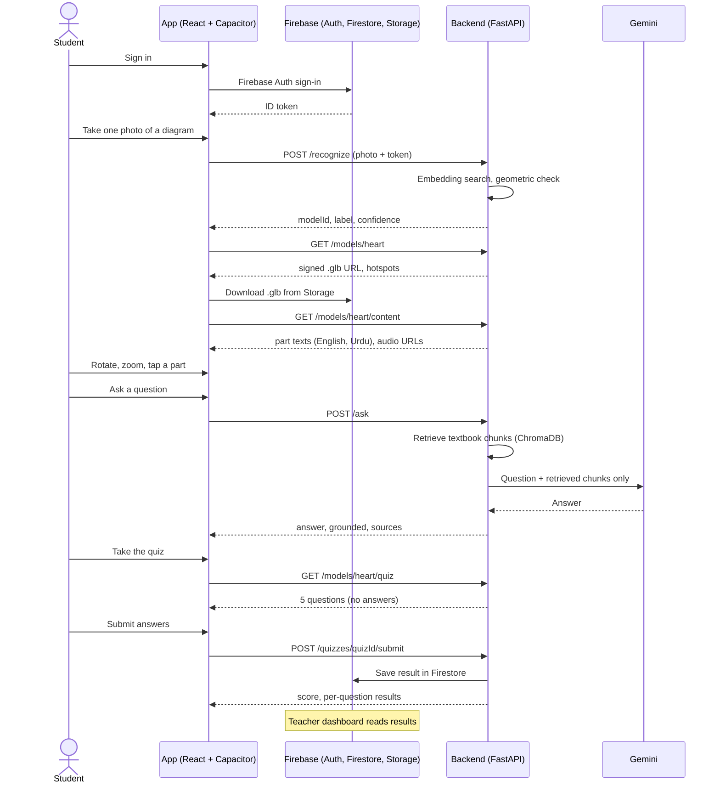
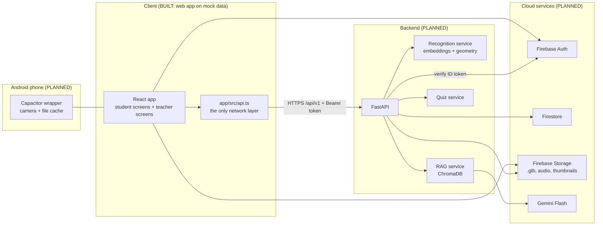

# TALEEM360

Scan a diagram in your Sindh Textbook Board science book. Explore it in 3D. Ask an AI tutor. Take a quiz. Your teacher sees the results.

**Labels used in this document**

- **BUILT (step X)**: exists in the repository today and was checked in that step.
- **PLANNED**: designed but not built yet. Nothing in the repo implements it.
- **PLACEHOLDER**: a route or file exists, but it only shows a "Coming in ..." page.
- **TBD**: not decided yet. We do not guess.

## Table of contents

1. [Project overview](#1-project-overview)
2. [Status and progress](#2-status-and-progress)
3. [How it works](#3-how-it-works)
4. [Tech stack](#4-tech-stack)
5. [Repository structure](#5-repository-structure)
6. [Getting started](#6-getting-started)
7. [Frontend in detail](#7-frontend-in-detail)
8. [Environment variables](#8-environment-variables)
9. [Backend integration](#9-backend-integration)
10. [API reference summary](#10-api-reference-summary)
11. [Recognition pipeline](#11-recognition-pipeline-planned)
12. [RAG tutor and quiz pipeline](#12-rag-tutor-and-quiz-pipeline-planned)
13. [Data model](#13-data-model-planned)
14. [3D assets plan](#14-3d-assets-plan)
15. [Security](#15-security)
16. [Git workflow](#16-git-workflow)
17. [Testing and verification checklist](#17-testing-and-verification-checklist)
18. [Known limitations and risks](#18-known-limitations-and-risks)
19. [Troubleshooting](#19-troubleshooting)
20. [Roadmap and glossary](#20-roadmap-and-glossary)

---

## 1. Project overview

**TALEEM360** is a STEM learning app for **STBB (Sindh Textbook Board) Classes 6 to 10**. It has two parts:

- a **student Android app** (React, packaged with Capacitor), and
- a **teacher web dashboard** (the same React project, desktop-first screens).

### The problem

Science diagrams in a printed textbook are flat. A student cannot rotate a heart, see inside a motor, or ask "why?" at home. Many students also study in both English and Urdu, and many use low-end Android phones.

### The idea

A student points the phone at a diagram in the book and takes **one photo**. The server recognises which diagram it is, and the app opens the matching **3D model**. The student can rotate and zoom it, tap parts to read short explanations in **English or Urdu**, ask an **AI tutor** that answers only from the textbook, and take a **5-question quiz**. Scores go to the teacher's dashboard.

### Who it is for

- **Students**, Classes 6 to 10, on low-end Android phones (target device: Redmi 12C).
- **Teachers**, who see class results on a laptop and can show a model on a projector.

### Team

| Role | Name |
|------|------|
| Team | Muhammad Umer Farooq, Muhammad Ebad Hafeez, Fizza Aman, Samrah Niazi |
| Supervisor | Miss Sadia Arshad |
| Co-supervisor | Dr. Usman Amjad |

### Scope: 12 models

| Class | Subject | Model |
|-------|---------|-------|
| 6 | Biology | Animal / plant cell |
| 7 | Biology | Digestive system |
| 8 | Science | Telescope |
| 6 to 8 | Science | Solar system (Ch 12 "Space and satellites" in the Class 6, 7 and 8 Science books) |
| 9 | Biology | Heart |
| 9 | Physics | Wind turbine |
| 9 | Chemistry | Bohr atom |
| 9 | Computer Science | Computer / motherboard |
| 10 | Biology | Lungs |
| 10 | Physics | DC motor |
| 10 | Chemistry | Hydrocarbon molecules |
| 10 | Computer Science | Logic gates / half-adder |

**Pilot = the heart only.** Everything is built and tested end to end on the heart first. The other 11 models reuse the same pipeline.

Exact chapter names for each model are TBD until the content is written.

---

## 2. Status and progress

| Step | Weight | Status |
|------|--------|--------|
| 0 | 5% | Done: monorepo skeleton |
| 1 | 15% | In progress: 1A done (Login, Home, responsive layout), 1B done (Scan, Fetching, Viewer), 1C pending (Ask, Quiz, Result, Teacher dashboard, Projector) |
| 2 | 10% | Pending |
| 3 | 15% | Pending |
| 4 | 10% | Pending |
| 5 | 10% | Pending |
| 6 | 10% | Pending |
| 7 | 5% | Pending |
| 8 | 10% | Pending |
| 9 | 10% | Pending |

**Total complete: 15%** (steps 0, 1A and 1B).

Git tags that exist: `step-0`, `step-1a`, `step-1b`.

Also done: 1A responsive layout fix, Docs-1 (this documentation). The same table is kept in [docs/PROGRESS.md](docs/PROGRESS.md).

---

## 3. How it works

### End-to-end flow

1. **Login** (student or teacher). BUILT (step 1A) as a mock screen. Real login with Firebase Auth is PLANNED.
2. **Scan one photo.** The student frames one diagram and presses the shutter. The camera closes after one photo. The screen is BUILT (step 1B) with a drawn placeholder instead of a real camera. The real camera (Capacitor) is PLANNED.
3. **Server recognition.** The photo is uploaded; the server decides which diagram it is. PLANNED. A mock does this today.
4. **"Fetching 3D Model from Database."** An animated screen shows three steps while the app recognises the diagram and fetches the model. BUILT (step 1B). If the diagram is unknown, the student sees "Diagram not found" and can retake the photo. BUILT (step 1B).
5. **Download and cache the `.glb` file.** PLANNED. The mock model has an empty `glbUrl`.
6. **In-app viewer.** Title, parts list, an explanation card, an English/Urdu toggle and an audio button are BUILT (step 1B). The 3D area is a flat drawing for now (BUILT, `ModelStage`). Real rotate, zoom and tap-on-part with `<model-viewer>` is PLANNED (step 2). Real audio is PLANNED.
7. **AI tutor** (RAG over the textbook + Gemini). PLANNED. The `/ask` screen is a placeholder.
8. **5-question multiple-choice quiz**, marked automatically. PLANNED. The `/quiz` and `/result` screens are placeholders.
9. **Results saved to Firestore.** PLANNED.
10. **Teacher dashboard and projector.** PLANNED. The `/teacher` and `/teacher/projector` routes are placeholders.

### Sequence diagram (target design)



### Architecture diagram (target design)



### Why one-time image recognition replaced continuous AR tracking

The original idea was live AR: keep tracking the diagram through the camera and draw the model on top (Unity with Vuforia or ARCore). We **dropped that** for three reasons:

- **Low-end phones.** Continuous tracking and 3D rendering together are heavy on a Redmi 12C.
- **Complexity and size.** A Unity app is large and slow to build; a React + Capacitor app is small and quick to change.
- **Reliability.** Textbook photos taken in classrooms are hard to track continuously. One good photo, checked on the server, is easier to make reliable.

The new design takes **one photo, recognises it once on the server, and opens a normal 3D viewer**. The earlier AR pilot repository **taleem360-pilot** is kept as a fallback. The change of approach still needs the supervisor's approval (see [Known limitations](#18-known-limitations-and-risks)).

---

## 4. Tech stack

Versions in the "Frontend (BUILT)" table are read from `app/package.json` (the `^` means "this version or a compatible newer one"). Planned versions are TBD until installed.

### Frontend (BUILT, step 1A and 1B)

| Layer | Tool | Version | Why chosen | Limitations |
|-------|------|---------|-----------|-------------|
| UI library | React | ^19.3.0 | Familiar to the team, large ecosystem | Needs a build step |
| UI library | react-dom | ^19.3.0 | Pairs with React | |
| Language | TypeScript | ^7.0.2 | Typed `api.ts` contract catches mistakes early | Slightly more setup |
| Build tool | Vite | ^8.3.4 | Fast dev server and small builds | |
| Vite plugin | @vitejs/plugin-react | ^6.1.2 | React support in Vite | |
| Routing | react-router-dom | ^7.18.4 | Simple client-side routes | |
| Font (English UI) | @fontsource/plus-jakarta-sans | ^5.3.0 | Bundled, works offline. Weights 400, 600, 700, 800 | Adds font files to the build |
| Font (Urdu) | @fontsource/noto-nastaliq-urdu | ^5.3.0 | Bundled, works offline. Weights 400, 600 | Large font files (about 160 to 220 kB each for the Arabic subset) |
| Styling | Plain CSS with CSS variables (design tokens) | n/a | No heavy UI library, small bundle | Hand-written styles |

### Planned layers

| Layer | Tool | Version | Why chosen | Limitations |
|-------|------|---------|-----------|-------------|
| Android packaging | Capacitor | TBD | Wraps the React app as an APK, gives camera and file access | Camera plugin quirks, WebView speed on low-end phones |
| 3D viewer | @google/model-viewer | TBD | Loads `.glb`, rotate, zoom and hotspots out of the box | WebView 3D speed on a Redmi 12C is untested |
| Backend | FastAPI (Python) | TBD | Quick to write, automatic validation, good for ML code | Free hosting may sleep or have little RAM |
| Recognition | DINOv2-small or CLIP embeddings | TBD (choose after testing) | Match a photo to registered diagrams without training | Only registered diagrams are recognised |
| Recognition (check) | ORB or SIFT + RANSAC (OpenCV) | TBD | Geometric proof that the photo really shows the matched diagram | Can fail on blurry or dark photos |
| Recognition (optional) | Caption OCR | TBD | Reads "Fig 9.4" as an extra clue | OCR can misread; optional only |
| Vector store | ChromaDB | TBD | Simple local store for textbook chunks | Needs disk persistence on the host |
| LLM | Gemini Flash via `google-genai` | TBD | Fast and has a free tier | Free-tier limits; must be kept grounded in textbook text |
| Auth | Firebase Authentication | TBD | Ready-made login, roles via custom claims | Free-tier limits |
| Database | Cloud Firestore | TBD | Simple document storage for results | Free-tier read and write limits |
| File storage | Firebase Storage | TBD | Stores `.glb`, audio and thumbnails | Free-tier limits |
| Hosting | TBD | TBD | Backend and dashboard | Not chosen yet |

---

## 5. Repository structure

Real tree at the end of step 1B (folders that only hold a `.gitkeep` are reserved for later steps).

```text
taleem360/
├── CLAUDE.md                 Rules for every Claude Code session (safety, responsive, git)
├── README.md                 This file
├── .env.example              Placeholder names for backend and Firebase variables (no values)
├── .gitignore                Keeps secrets, build output and local data out of git
├── docs/
│   ├── README.md             One-line note about this folder
│   ├── PROGRESS.md           Progress table for steps 0 to 9
│   ├── API.md                Full API contract (PLANNED)
│   └── ui-preview/           READ-ONLY UI reference (screenshots/ and source/*.dc.html)
├── brand/
│   └── README.md             Reserved for logos and brand assets
├── app/                      The React project (package.json lives here, not in the root)
│   ├── README.md             One-line note
│   ├── package.json          Dependencies and scripts (dev, build, preview)
│   ├── package-lock.json     Exact installed versions
│   ├── index.html            Page shell (viewport-fit=cover, theme colour)
│   ├── vite.config.ts        Vite config with the React plugin
│   ├── tsconfig.json         TypeScript settings (strict)
│   ├── .env.example          VITE_USE_MOCK and VITE_BACKEND_URL placeholders
│   ├── .gitignore            node_modules, dist, .env files
│   ├── public/fonts/         Reserved (fonts currently come from @fontsource)
│   └── src/
│       ├── main.tsx          Starts React, router, fonts and stylesheets
│       ├── App.tsx           Route table
│       ├── api.ts            The ONLY place that talks to a backend (mock or real)
│       ├── vite-env.d.ts     Types for the VITE_* variables
│       ├── styles.css        Design tokens, StudentShell, Login, Home, tab bar
│       ├── styles-1b.css     Scan, Fetching and Viewer styles
│       ├── mock/
│       │   └── data.ts       Sample data and its TypeScript types
│       ├── components/
│       │   ├── StudentShell.tsx   The one layout for every student screen
│       │   ├── TabBar.tsx         Bottom tab bar (Home, Scan, Quizzes)
│       │   ├── ModelStage.tsx     The 3D area (flat SVG stand-in today)
│       │   └── Icons.tsx          Inline SVG icons
│       └── screens/
│           ├── Placeholder.tsx    "Coming in ..." page for unbuilt routes
│           ├── student/
│           │   ├── Login.tsx      BUILT (1A)
│           │   ├── Home.tsx       BUILT (1A)
│           │   ├── Scan.tsx       BUILT (1B)
│           │   ├── Fetching.tsx   BUILT (1B)
│           │   └── Viewer.tsx     BUILT (1B)
│           └── teacher/           Reserved (empty, teacher screens come in 1C)
├── backend/                  PLANNED FastAPI backend (folders only, no code yet)
│   ├── README.md
│   ├── app/routers/          Reserved for route modules
│   ├── app/services/         Reserved for recognition, RAG and quiz services
│   ├── scripts/              Reserved for build and evaluation scripts
│   └── tests/                Reserved for backend tests
└── content/                  PLANNED learning content (folders only, no files yet)
    ├── README.md
    ├── models/               .glb files
    ├── references/           Reference images of textbook diagrams
    ├── test_photos/          Our own test photos for the recognition target
    ├── textbook_chunks/      Textbook text split into chunks for RAG
    └── quiz/                 Reviewed quiz questions
```

---

## 6. Getting started

Commands are for **Windows PowerShell**, one per line.

### Prerequisites

- **Node.js 18 or newer** (the project was built and checked with Node 24).
- **npm** (comes with Node).
- **git**.

Check them:

```powershell
node -v
npm -v
git --version
```

### Clone and install

```powershell
git clone <your-repository-url>
cd taleem360
cd app
npm install
```

`package.json` is in `app/`. Always run npm commands inside `app/`.

### Run the dev server

```powershell
npm run dev
```

Open the address Vite prints (usually `http://localhost:5173`). The app starts at the Login screen.

### Build for production

```powershell
npm run build
```

This runs the TypeScript check (`tsc -b`) and then `vite build`. The output goes to `app/dist/` (ignored by git). To look at the built version:

```powershell
npm run preview
```

### Try it on a real phone (same Wi-Fi)

```powershell
npm run dev -- --host
```

Vite prints a **Network** address such as `http://192.168.x.x:5173`. Open it in the phone's browser. The phone and the computer must be on the same Wi-Fi. If it does not load, allow Node through the Windows firewall when Windows asks.

### Mock mode

The app uses **mock data** by default (`VITE_USE_MOCK` is `true` unless it is exactly `false`). No backend is needed. Every call returns sample data after a short fake delay (350 ms).

### Test URLs

| URL | What it does |
|-----|--------------|
| `/login` | Start screen. Any email and password work in mock mode |
| `/home` | Home screen with sample student "Ayesha", Class 9 |
| `/scan` | Placeholder camera screen |
| `/fetching` | Normal flow: three steps, then opens `/viewer?model=heart` by itself (about 3 seconds) |
| `/fetching?fail=1` | **Mock only.** Forces "Diagram not found" with a "Retake photo" button |
| `/viewer?model=heart` | The viewer for the heart. `/viewer` with no `model` also opens the heart |
| `/ask`, `/quiz`, `/result`, `/teacher`, `/teacher/projector` | PLACEHOLDER pages |

---

## 7. Frontend in detail

### Routes

Defined in `app/src/App.tsx`. Any unknown path redirects to `/login`.

| Path | Screen file | Status | What it does | Where its buttons go |
|------|-------------|--------|--------------|----------------------|
| `/` | none | BUILT (1A) | Redirects | `/login` |
| `/login` | `screens/student/Login.tsx` | BUILT (1A) | Email and password form, calls `api.login` | "Sign in as student" goes to `/home`. "I am a teacher" goes to `/teacher` |
| `/home` | `screens/student/Home.tsx` | BUILT (1A) | Greeting, scan card, four subject cards, recently opened, tab bar | Scan card goes to `/scan`. Subject cards go to `/scan`. Recently opened goes to `/viewer`. Tabs: Home `/home`, Scan `/scan`, Quizzes `/quiz` |
| `/scan` | `screens/student/Scan.tsx` | BUILT (1B) | Camera-style screen with a drawn textbook page, framing box, hint, shutter. **No real camera** | Close (X) goes to `/home`. Shutter goes to `/fetching` |
| `/fetching` | `screens/student/Fetching.tsx` | BUILT (1B) | Calls `api.recognize` then `api.getModel`, shows three animated steps, then opens the viewer. Shows "Diagram not found" or "Something went wrong" on failure | Automatic to `/viewer?model=<id>`. "Open the model" (enabled when done) goes to the viewer. "Wrong diagram? Scan again" goes to `/scan`. On failure: "Retake photo" goes to `/scan`, "Back to home" goes to `/home` |
| `/viewer` | `screens/student/Viewer.tsx` | BUILT (1B) | Title line, `ModelStage`, part buttons, explanation card, EN/Urdu toggle, audio button (UI only) | Back goes to `/home`. "Ask AI tutor" goes to `/ask?model=<id>`. "Take quiz" goes to `/quiz?model=<id>` |
| `/ask` | `screens/Placeholder.tsx` | PLACEHOLDER (1C) | "Coming in 1C", student shell | "Back to home" |
| `/quiz` | `screens/Placeholder.tsx` | PLACEHOLDER (1C) | "Coming in 1C", student shell | "Back to home" |
| `/result` | `screens/Placeholder.tsx` | PLACEHOLDER (1C) | "Coming in 1C", student shell | "Back to home" |
| `/teacher` | `screens/Placeholder.tsx` | PLACEHOLDER (1C) | "Coming in 1C", full width, no student shell | "Back to login" |
| `/teacher/projector` | `screens/Placeholder.tsx` | PLACEHOLDER (1C) | "Coming in 1C", full width, no student shell | "Back to login" |

### Layout and responsive rules

All student screens use **one** layout component, `components/StudentShell.tsx`. It takes a `tone` (`light`, `dark`, `camera` or `stage`), an optional `bottomBar` (the tab bar) and optional `decor` (such as the Login rings).

| Width | Behaviour |
|-------|-----------|
| 480 px or less (phone) | The screen fills the whole viewport, edge to edge, using `100dvh` so mobile browser bars do not cut it off |
| 481 px or more (tablet, laptop) | One centred column, `max-width: 430px`, full height, on a dark page (`#0B1624`) with a subtle border and shadow |

More rules (also in [CLAUDE.md](CLAUDE.md)):

- Content scrolls vertically **inside** the column. The bottom tab bar stays fixed at the bottom of the column.
- Decorations are clipped to the column, not the window.
- Safe areas: `viewport-fit=cover` is set in `index.html`; headers and bottom bars use `env(safe-area-inset-top)` and `env(safe-area-inset-bottom)`.
- Landscape phones (height under 500 px): the content scrolls, and the tab bar shrinks to 56 px with its icon and label side by side.
- No horizontal scroll anywhere.
- Teacher routes do **not** use `StudentShell`. They are full-width and desktop-first (PLACEHOLDER until step 1C).

### ModelStage and why step 2 swaps only it

`components/ModelStage.tsx` draws the 3D area. Today it draws a **flat SVG heart** with clickable hotspot dots (BUILT, step 1B). Its props are:

```ts
interface ModelStageProps {
  model: ModelInfo          // title, parts (with id, name, colour) and so on
  selectedPartId: string    // which part is highlighted
  onSelectPart: (partId: string) => void
}
```

The Viewer screen only knows these three props. It does not know how the 3D is drawn. In **step 2 (PLANNED)** only this file is replaced by a component that wraps `<model-viewer>` and loads the real `.glb`. The part list, explanation card, language toggle and buttons stay exactly as they are.

Today the hotspot positions in `ModelStage` are hard-coded for the heart's four parts. With the real viewer they come from the `hotspots` field of the model.

### Design tokens

Defined as CSS variables in `app/src/styles.css`.

| Token | Value | Use |
|-------|-------|-----|
| `--ink` | `#0E1B2C` | Dark background, text on teal |
| `--primary` | `#0F766E` | Main brand colour, buttons, active tab |
| `--teal` | `#14B8A6` | Accent, shutter, primary button on dark |
| `--amber` | `#F59E0B` | Framing box, warnings |
| `--heart` | `#D6304A` | Heart / Biology icon colour |
| `--bg` | `#F4F7FA` | Light page background |
| `--card-border` | `#E3E9F0` | Card and chip borders |
| `--text` | `#12263A` | Body text |
| `--muted` | `#5B6B7D` | Secondary text |
| `--dark-muted` | `#B8C7D9` | Secondary text on dark |
| `--dark-faint` | `#8DA2BA` | Faint text on dark |
| `--dark-field` | `#15263B` | Input background on dark |
| `--dark-border` | `#2B3F57` | Input border on dark |

Other fixed colours: page behind the column `#0B1624`, camera screen `#0A121C`, viewer background gradient `#16283F` to `#0E1B2C`.

| Font | Use | Weights |
|------|-----|---------|
| Plus Jakarta Sans | All English UI text | 400, 600, 700, 800 |
| Noto Nastaliq Urdu | All Urdu text (class `.urdu`) | 400, 600 |

Spacing is hand-written in CSS (screen side padding 24 to 28 px, card radius 16 px, buttons 52 to 54 px high). The reference screens are in `docs/ui-preview/` (read-only).

### Mock data shapes

From `app/src/mock/data.ts` (all names and scores are sample data):

```ts
Student      { id, name, classLevel, email }
ModelPart    { id, color, name, nameUr, description, descriptionUr }
ModelInfo    { id, title, subject, chapter, classLevel, glbUrl, defaultPartId?, parts: ModelPart[] }
Subject      { id, name, topics }
RecentItem   { modelId, title, subtitle }
HomeData     { student, subjects: Subject[], recent: RecentItem[] }
QuizQuestion { id, text, options: string[], correctIndex }
QuizResult   { score, total, strong: string[], review: string[] }
TeacherRow   { student, model, score, total }
TeacherResults { classLabel, quizTitle, takers, classAverage, mostScanned, rows, topics: {name, percentCorrect}[] }
```

The mock heart has four parts: Veins, Pulmonary trunk, Valves, Aorta (default). The mock quiz has 5 heart questions.

### How `api.ts` works

`app/src/api.ts` is the **only** file that talks to a backend. Screens import its functions and never call `fetch` themselves.

- `VITE_USE_MOCK`: mock mode is on unless the value is exactly `false`.
- `VITE_BACKEND_URL`: prefix for real requests (`${VITE_BACKEND_URL}${path}`).
- In mock mode every function waits 350 ms and returns sample data from `mock/data.ts`.
- In real mode a small `http()` helper calls `fetch` and throws a generic `Error` if the status is not OK.

| Function | Mock behaviour today | Real path coded today (real mode) |
|----------|----------------------|-----------------------------------|
| `login(email, password)` | Returns `{ token: 'mock-token', role: 'student', student }` for any input | `POST /auth/login` |
| `getHomeData()` | Returns the sample home data | `GET /home` |
| `recognize(photo, { mockFail? })` | Returns `ok` for the heart (`confidence 0.94`, label "Human heart, Fig 9.4"), or `not_found` if `mockFail` is true | `POST /recognize` (multipart, field `photo`) |
| `getModel(id)` | Returns the heart model with the given `id` (`glbUrl` is empty) | `GET /models/{id}` |
| `getContent(id)` | Returns a short heart summary in English and Urdu | `GET /content/{id}` |
| `askQuestion(id, text)` | Returns one fixed sample answer | `POST /ask` with body `{ id, text }` |
| `getQuiz(id)` | Returns the 5 mock questions (including `correctIndex`) | `GET /quiz/{id}` |
| `submitQuiz(id, answers)` | Marks the answers inside the app against the mock `correctIndex` | `POST /quiz/{id}/submit` with body `{ answers }` |
| `getTeacherResults()` | Returns the sample class results | `GET /teacher/results` |

The target contract is in [docs/API.md](docs/API.md). The differences are listed in [section 9](#9-backend-integration).

### Urdu and language handling

- There is **no i18n library**. English and Urdu text both come from the data (`name` / `nameUr`, `description` / `descriptionUr`).
- The Viewer has an **EN / اردو** toggle. In Urdu mode the part name and explanation are shown in Urdu only.
- Urdu text uses the `.urdu` class: font Noto Nastaliq Urdu, `direction: rtl`, `dir="rtl"` and `lang="ur"` on the element, and a roomy line height (about 2.3 on the explanation) so the tall script is not clipped.
- Both fonts are bundled by `@fontsource`, so they work offline.
- The app's own labels (buttons, hints, headings) are **English only** today. Translating the interface is TBD.
- Audio for each part in both languages is PLANNED (not recorded yet). The audio button is UI only.

### Accessibility and tap targets

- Every tappable element is at least **44 x 44 px**. Hotspots are 44 px buttons around a smaller visible dot.
- Inputs use a font size of at least 16 px (this also stops iOS-style zoom on focus).
- No hover-only behaviour.
- Icon-only buttons have `aria-label`; toggle buttons use `aria-pressed`; the Fetching progress bar has `role="progressbar"` and the status line is `aria-live`.
- The pulsing step animation and the progress transition are turned off when the user prefers reduced motion.
- Decorative SVGs are `aria-hidden`; the figure drawings have text labels.

---

## 8. Environment variables

**Never put real values in this file, in git, or in chat.** Real values live only in `.env` files, which are in `.gitignore`. Only `.env.example` files (placeholders) are committed.

### App (`app/.env`)

| Name | Status | Meaning | Example placeholder |
|------|--------|---------|---------------------|
| `VITE_USE_MOCK` | BUILT (1A) | `true` uses mock data. Set to `false` to call the real backend | `true` |
| `VITE_BACKEND_URL` | BUILT (1A) | Backend origin, no trailing slash. When the contract is applied the code will add `/api/v1` | `http://localhost:8000` |
| `VITE_FIREBASE_API_KEY` | PLANNED | Firebase web config for Auth, Firestore and Storage | `your-firebase-api-key` |
| `VITE_FIREBASE_AUTH_DOMAIN` | PLANNED | Same | `your-project.firebaseapp.com` |
| `VITE_FIREBASE_PROJECT_ID` | PLANNED | Same | `your-project-id` |
| `VITE_FIREBASE_STORAGE_BUCKET` | PLANNED | Same | `your-project.appspot.com` |
| `VITE_FIREBASE_MESSAGING_SENDER_ID` | PLANNED | Same | `your-sender-id` |
| `VITE_FIREBASE_APP_ID` | PLANNED | Same | `your-app-id` |

Anything starting with `VITE_` is visible to anyone who opens the app, so it must never be a secret. (Firebase web config values are identifiers, not secrets; access is protected by Firebase rules.)

### Backend (`backend/.env`, PLANNED)

| Name | Meaning | Example placeholder |
|------|---------|---------------------|
| `GEMINI_API_KEY` | Key for Gemini. **Secret** | `your-gemini-api-key` |
| `FIREBASE_PROJECT_ID` | Firebase project used to verify ID tokens | `your-project-id` |
| `GOOGLE_APPLICATION_CREDENTIALS` | Path to the Firebase service-account file on the server. The file itself is **never** committed | `path/to/service-account.json` |
| `CHROMA_PATH` | Folder where ChromaDB stores its data | `./chroma_db` |
| `ALLOWED_ORIGINS` | Comma-separated list of allowed web origins for CORS | `http://localhost:5173` |

The exact backend variable names are TBD until step 4; these are the planned names.

### Root `.env.example` (BUILT, step 0; names updated in Docs-1b)

The root file lists the same placeholder names as the two tables above: the `VITE_*` variables for the app (copy them into `app/.env`) and the backend variables (copy them into `backend/.env`). It contains placeholders only.

---

## 9. Backend integration

### Rules

- The React app talks to the backend **only** through `app/src/api.ts`. No screen calls `fetch`.
- Mock data first: every feature is built and checked on mock data before a backend exists.
- Base URL: `${VITE_BACKEND_URL}/api/v1`. The version is in the path.
- Auth: a **Firebase ID token** in `Authorization: Bearer <token>` on every endpoint except `GET /health`. The role (`student` or `teacher`) is a custom claim. Teacher endpoints return 403 to students.
- Login is done by the Firebase Auth SDK in the app (step 5), not by a backend endpoint.
- Requests and responses are JSON, except the photo upload (`multipart/form-data`).
- Errors use one format for every non-2xx response:

```json
{ "error": { "code": "not_found", "message": "Model 'xyz' does not exist." } }
```

  Codes: `invalid_image`, `too_large`, `unauthorized`, `forbidden`, `not_found`, `rate_limited`, `server_error`. A "diagram not recognised" result is a normal `200` with `"status": "not_found"`.
- **CORS:** the backend allows only the origins in `ALLOWED_ORIGINS` (the dev server and the real dashboard origin). The Android app runs from a Capacitor origin, which must be added to the list (exact value TBD in step 7).

### Switching from mock to real

1. Start the backend (PLANNED).
2. In `app/.env` set:

```text
VITE_USE_MOCK=false
VITE_BACKEND_URL=http://localhost:8000
```

3. Restart `npm run dev` (Vite reads `.env` at start).

No screen code changes. That is the point of `api.ts`. Step 4 will first align `api.ts` with the contract (see the gaps below).

### Known gaps: current real-mode `api.ts` versus the contract

Nothing was changed in code for this document. This list is for step 4.

**Applies to all functions**

1. **No `/api/v1` prefix.** The code calls `${VITE_BACKEND_URL}${path}`; the contract is `${VITE_BACKEND_URL}/api/v1${path}`.
2. **No `Authorization` header.** The code never sends a Firebase ID token.
3. **Errors are not parsed.** `http()` throws `Request failed: <status>` and ignores the `{"error": {"code", "message"}}` body, so the app cannot tell `rate_limited` from `server_error`.

**Per function**

| # | `api.ts` function | Difference |
|---|-------------------|------------|
| 4 | `login` | Calls `POST /auth/login`. The contract has **no** login endpoint (Firebase Auth SDK in step 5). Its `LoginResult` type (`token`, `role`, `student`) will change. There is also no `GET /me` function yet |
| 5 | `getHomeData` | Path `/home` matches. Response shape differs: code `subjects[].topics` vs contract `examples`; code `recent[]` is `{ modelId, title, subtitle }` vs contract `{ modelId, title, subject, chapter }`; code `student` has `id` and `email`, contract has `name` and `classLevel` only |
| 6 | `recognize` | Path and field `photo` match. The result type lacks `matchedBy`, `figure`, `reason` and `tip`. There is **no client-side resize** to 1024 px and no 1 MB / 5 MB handling. The Fetching screen currently sends an **empty placeholder blob**, not a photo. The `mockFail` option is mock-only (fine) |
| 7 | `getModel` | Path `/models/{id}` matches. The code's `ModelInfo` contains `parts[]` (names, Urdu names, texts, colours) and `defaultPartId`; the contract's model has **no parts**. It has `titleUr`, `glbExpiresAt`, `glbSizeBytes`, `version` and `hotspots[]`. Parts come from the content endpoint |
| 8 | `getContent` | Code path `/content/{id}`; contract `/models/{id}/content`. Code type `{ id, title, summary, summaryUr }`; contract `{ modelId, source, parts[] }` |
| 9 | `askQuestion` | Path `/ask` matches. Code signature `(id, text)` and body `{ id, text }`; contract body `{ modelId, partId?, question, lang }`. The function has no `partId` or `lang` parameters. Code response `{ answer, sources: string[] }`; contract `{ answer, lang, grounded, sources: [{ book, chapter, page }] }` |
| 10 | `getQuiz` | Code path `/quiz/{id}`; contract `/models/{id}/quiz`. Code returns a bare array whose items contain **`correctIndex`** and `options: string[]`; the contract returns `{ quizId, modelId, questions: [{ id, text, options: [{ id, text }] }] }` and **never** includes correct answers |
| 11 | `submitQuiz` | Code path `/quiz/{id}/submit` (takes the model id); contract `/quizzes/{quizId}/submit` (takes `quizId` from the quiz response). Code body `{ answers: number[] }`; contract `{ answers: [{ questionId, optionId }] }`. Code response `{ score, total, strong, review }`; contract `{ score, total, results[], savedResultId }`. The **mock marks the quiz inside the app** using `correctIndex`; in the real design only the server marks |
| 12 | `getTeacherResults` | Path `/teacher/results` matches but the code sends **no** `classId` or `modelId` query. Response differs: code `{ classLabel, quizTitle, takers, classAverage, mostScanned, rows[{ student, model, score, total }], topics[{ name, percentCorrect }] }`; contract `{ summary{ studentsTaken, classAverage, mostScannedModel }, rows[{ studentName, modelId, score, total, label }], weakTopics[{ topic, percentCorrect }] }` |
| 13 | missing functions | No function for `GET /health`, `GET /me` or `GET /models` (list) yet |

**Screens that will change when the types change**

- `Home.tsx` reads `subjects[].topics` and `recent[].subtitle`.
- `Viewer.tsx` and `ModelStage.tsx` read `model.parts`, which will move to the content response.
- The Home "recently opened" link goes to `/viewer` without a `model` parameter, so the Viewer falls back to `heart`.

---

## 10. API reference summary

All endpoints are **PLANNED**. Every one is mocked in `api.ts` today. Base URL `${VITE_BACKEND_URL}/api/v1`. Full details, request and response examples: **[docs/API.md](docs/API.md)**.

| Method | Path | Auth | Purpose | `api.ts` function | Status |
|--------|------|------|---------|-------------------|--------|
| GET | `/health` | none | Liveness and version | none yet | PLANNED |
| GET | `/me` | student or teacher | Current user, role, class | none yet | PLANNED |
| GET | `/home` | student | Home screen data | `getHomeData` | PLANNED |
| GET | `/models?subject=&classLevel=` | student or teacher | List models | none yet | PLANNED |
| POST | `/recognize` | student | Photo to model id | `recognize` | PLANNED |
| GET | `/models/{id}` | student or teacher | Model info and signed `.glb` URL | `getModel` | PLANNED |
| GET | `/models/{id}/content` | student or teacher | Part texts (English, Urdu), audio URLs | `getContent` | PLANNED |
| POST | `/ask` | student | AI tutor answer from the textbook | `askQuestion` | PLANNED |
| GET | `/models/{id}/quiz` | student | 5 questions, no answers | `getQuiz` | PLANNED |
| POST | `/quizzes/{quizId}/submit` | student | Mark quiz, save result | `submitQuiz` | PLANNED |
| GET | `/teacher/results?classId=&modelId=` | teacher only | Class results | `getTeacherResults` | PLANNED |
| none | `/teacher/projector?model=<id>` (a screen, not an endpoint) | teacher | Client-only projector view | none | PLANNED |

Rate limit (planned): 30 requests per minute per user on `/recognize` and `/ask`.

---

## 11. Recognition pipeline (PLANNED)

Goal: given one photo, say which registered textbook diagram it shows, or say "not found". Nothing here is built yet.

1. **Reference images.** For each diagram we keep one or more clean reference images in `content/references/`, listed in the registry (see [section 13](#13-data-model-planned)).
2. **Embeddings.** Each reference image is turned into a vector with DINOv2-small or CLIP (we choose by testing on our own photos). The vectors are stored in an index.
3. **Search.** The uploaded photo (resized to a longest side of 1024 px) gets a vector. We find the **top 5** closest references.
4. **Geometric verification.** For the best candidates we match ORB or SIFT keypoints between the photo and the reference and run **RANSAC** to check that the two images really share the same layout. This stops "looks similar" mistakes.
5. **"Not found" rule.** If the best candidate has low similarity, or the geometric check fails, the server returns `status: "not_found"` with a tip. It never guesses. Exact thresholds are TBD and will be set from test results.
6. **Optional caption OCR.** Reading a caption such as "Fig 9.4" can add a clue or break a tie. Optional, only if testing shows it helps.
7. **Result.** On success the server returns the model id, label, confidence, which method matched (`matchedBy`) and the figure name.

**Target:** at least **90% top-1 accuracy on our own test photos** (photos of the real textbook pages taken with the target phone in normal classroom light, kept in `content/test_photos/`). This is a **goal, not a result**. No measurement exists yet.

**Evaluation script plan:** `backend/scripts/` will get a script that runs every test photo through the pipeline and prints top-1 accuracy, top-5 accuracy, the not-found rate and a list of wrong answers, so thresholds can be tuned.

**Risks:** blurry or dark photos; glare on glossy pages; photos that cut off part of the figure; diagrams that look alike across chapters; needing permission to use the textbook images; only registered diagrams can ever be recognised.

---

## 12. RAG tutor and quiz pipeline (PLANNED)

### Tutor (RAG)

1. **Chunking.** The textbook text for each model's chapter is split into short chunks (a few sentences each) with the book, chapter and page kept as metadata. Chunks go in `content/textbook_chunks/`.
2. **Store.** Chunks are embedded and stored in **ChromaDB** (`CHROMA_PATH`).
3. **Retrieve.** For each question the backend retrieves the closest chunks, filtered by the current model.
4. **Prompt.** Gemini Flash gets the question and **only the retrieved chunks**, with the instruction to answer only from them, in the student's language (English or Urdu).
5. **"Not in your book" fallback.** If nothing relevant is retrieved, or the model says the chunks do not contain the answer, the backend returns `grounded: false` and an answer that says it was not found in the book. It must not answer from general knowledge.
6. **Sources.** Every grounded answer lists its sources (book, chapter, page).

### Quiz

- Each model has a **5-question multiple-choice quiz**, generated **once** per model (with Gemini from the textbook chunks), then **stored** (`content/quiz/` and Firestore).
- A teacher or team member **reviews** the questions before they go live.
- `GET /models/{id}/quiz` returns the questions and options only. **Correct answers are never sent to the client before submitting.**
- `POST /quizzes/{quizId}/submit` marks the answers on the server, saves the result and then returns which answers were right.

---

## 13. Data model (PLANNED)

Nothing in this section exists yet. Field names may change in steps 5 and 6.

### Firestore collections

**`users`** (document id = Firebase uid)

| Field | Type | Notes |
|-------|------|-------|
| `name` | string | Display name |
| `role` | string | `student` or `teacher` (also a custom claim) |
| `classLevel` | number | 6 to 10, students only |
| `classId` | string | Which class the user belongs to |
| `createdAt` | timestamp | |

**`classes`**

| Field | Type | Notes |
|-------|------|-------|
| `name` | string | For example "Class 9-A" |
| `classLevel` | number | |
| `teacherUid` | string | |
| `studentUids` | array of strings | |

**`scans`**

| Field | Type | Notes |
|-------|------|-------|
| `studentUid` | string | |
| `modelId` | string | |
| `confidence` | number | |
| `createdAt` | timestamp | The photo itself is **not** stored |

**`quizResults`**

| Field | Type | Notes |
|-------|------|-------|
| `studentUid` | string | |
| `classId` | string | |
| `modelId` | string | |
| `quizId` | string | |
| `score` | number | |
| `total` | number | |
| `answers` | array | `{ questionId, optionId, correct, topic }` |
| `createdAt` | timestamp | |

### Firebase Storage layout

```text
models/{modelId}.glb             3D models (version in metadata)
thumbs/{modelId}.webp            Thumbnails
audio/{modelId}/{partId}-en.mp3  English audio
audio/{modelId}/{partId}-ur.mp3  Urdu audio
```

### `content/registry.json` schema

One file links everything. Illustrative example (TBD until step 3):

```json
{
  "diagrams": [
    {
      "id": "heart-fig-9-4",
      "figure": "Fig 9.4",
      "referenceImages": ["references/heart-fig-9-4.jpg"],
      "modelId": "heart",
      "model": "models/heart.glb",
      "subject": "Biology",
      "classLevel": 9,
      "chapter": "Ch 9 Transport",
      "topic": "Human heart",
      "chunks": ["textbook_chunks/class9-bio-ch9.jsonl"],
      "quiz": "quiz/heart.json"
    }
  ]
}
```

The chain is: diagram, reference image, model, subject / class / topic, textbook chunks.

### `.glb` requirements

- Compressed (for example Draco or meshopt), **under about 3 MB** per model so it loads on a weak connection and phone.
- **One named material per part**, or hotspots defined for each part, so the app can highlight and label parts.
- Part names must match the `part.id` values used in the content endpoint.

---

## 14. 3D assets plan

| Phase | Models | Method |
|-------|--------|--------|
| Phase 1 | Cell, digestive system, telescope, heart, lungs | **Meshy** (AI generation) for organic and object models, or **Sketchfab** models that are already split into parts |
| Phase 2 | The other 7 (solar system, wind turbine, Bohr atom, computer / motherboard, DC motor, hydrocarbon molecules, logic gates / half-adder) | Mix of Meshy, Sketchfab and hand-built models |

Models that are better **built by hand** (for example in Blender): DC motor, atom, molecules, logic gates, because they must be exact and split into named parts.

Checks for every model:

- **Licence:** the licence allows use in an educational app (Sketchfab models must be CC-licensed for reuse; note the credit).
- **Textbook accuracy:** the parts and their names match the STBB textbook and a teacher agrees.
- **Size and parts:** under about 3 MB, one named material per part (Meshy often outputs a **single mesh**, which must be split before it is useful).

---

## 15. Security

- **Secrets policy:** never commit `.env`, API keys, passwords, tokens, Firebase service-account files or keys of any kind. Only `.env.example` with placeholder names is committed. Before every commit run `git status` and `git diff --staged` and check for secrets.
- **`.gitignore` covers:** `node_modules`, `.env`, `.env.*` (except `.env.example`), `*.pem`, `*.key`, `serviceAccount*.json`, `firebase-adminsdk*.json`, `google-services.json`, `GoogleService-Info.plist`, `.firebase/`, `__pycache__`, `venv`, `dist`, `app/android/build`, `*.pdf`, ChromaDB folders (`chroma/`, `chroma_db/`, `.chroma/`), `*.sqlite3`, `*.tsbuildinfo`, `.vscode/`, `Thumbs.db`, `.DS_Store`.
- **Firebase rules plan (PLANNED):** students can read their own `users` document and their own `quizResults`, and cannot write results directly (only the backend can). Teachers can read results for their own classes only. Storage files are read through signed URLs. Rules are tested before release.
- **Token auth (PLANNED):** every endpoint except `/health` needs a Firebase ID token, verified on the server. Roles are custom claims; teacher endpoints return 403 to students.
- **Rate limiting (PLANNED):** for example 30 requests per minute per user on `/recognize` and `/ask`.
- **Photo handling:** the photo is used for recognition and then discarded. It is **not stored** unless we later decide we need it for improving recognition (TBD, would need consent).
- **Textbook content:** STBB diagrams are used for **internal matching only** and are not republished. Permission is still to be confirmed (see risks).
- **VITE variables are public.** Never put a secret in a `VITE_*` variable.
- **No real personal data in the repository or docs.** Names in mock data and examples are samples.

---

## 16. Git workflow

- **One step at a time.** Each step is small and checked before the next.
- **Claude Code never commits.** It must not run `git add`, `git commit`, `git tag` or `git push`. The user does that in PowerShell after each step.
- **Before committing,** check for secrets:

```powershell
git status
git diff --staged
```

- **Commit message format:** `Step N: short description`, for example `Step 1B: Scan, Fetching, Viewer screens with ModelStage`.
- **Tags:** `step-0`, `step-1a`, `step-1b`, and so on, one per finished step.
- **Typical sequence:**

```powershell
git add .
git status
git commit -m "Step N: short description"
git tag step-n
git push origin main --tags
```

- **Branches:** work is on `main` for now. When Muhammad Ebad Hafeez joins, use `feature/*` branches and merge them through pull requests.
- **CRLF warnings** such as "LF will be replaced by CRLF" on Windows are harmless.

---

## 17. Testing and verification checklist

Do these at the end of **every** step.

- [ ] `cd app` then `npm run build` finishes with no errors.
- [ ] `npm run dev` starts and the changed screens open.
- [ ] Layout checked at 360x640, 390x844, 412x915, 844x390 (landscape), 768x1024, 1366x768 and 1920x1080: no horizontal scroll, nothing overlapped by the tab bar.
- [ ] Every tappable element is at least 44 x 44 px; inputs are at least 16 px.
- [ ] Urdu text (if shown) is not clipped and reads right to left.
- [ ] Mock mode works with no backend running.
- [ ] No change to code that already worked (compare with `git diff`).
- [ ] `.gitignore` still covers `.env`, `node_modules` and `dist`; no secrets in `git status` or `git diff --staged`.
- [ ] `README.md` and `docs/PROGRESS.md` updated.
- [ ] Commit, tag and push done by the user.

Backend steps (PLANNED) add: every endpoint in `docs/API.md` returns the documented shape and error format; the quiz response contains no correct answers; the teacher endpoint returns 403 for a student token.

---

## 18. Known limitations and risks

| Risk | Detail |
|------|--------|
| WebView 3D speed | A 3D model inside Android WebView on a Redmi 12C may be slow or stutter. Not tested yet. This is why models are kept under about 3 MB |
| Capacitor camera plugin | Camera plugins have quirks across Android versions (permissions, orientation, image size). The real camera is not built yet |
| Free hosting | Free backend hosting may have little RAM (embedding models are heavy) and may sleep, making the first request slow |
| Free tiers | Gemini and Firebase free tiers have request limits. A whole class using the app at once could hit them |
| Only registered diagrams | Recognition only knows diagrams we registered. Anything else returns "not found" |
| Meshy single mesh | Meshy often outputs one mesh with one material. It must be split into named parts before tapping parts works |
| Urdu font bundling | The Urdu font files are large (about 160 to 220 kB each), which adds to the app size. They are bundled so Urdu works offline |
| Audio | English and Urdu audio for each part is still to be recorded |
| Textbook diagram permission | We need permission (or a safe way) to use STBB diagrams as reference images |
| Supervisor approval | The change from live AR to one-time recognition must be approved by the supervisor |
| Mock only | Today nothing talks to a real server, so real network behaviour, errors and speed are untested |
| Quiz marked in the app (mock) | The mock marks the quiz in the app using `correctIndex`. This is replaced by server-side marking |

---

## 19. Troubleshooting

**"Repository not found" when pushing, even though the repo exists.** A stale GitHub credential is stored in Windows. Clear it, then push again and sign in when asked:

```powershell
git credential-manager erase
```

When it waits for input, type these two lines, then press Enter on an empty line:

```text
protocol=https
host=github.com
```

**`npm` says it cannot find `package.json`.** You are in the wrong folder. `package.json` is in `app/`, not the repository root:

```powershell
cd app
npm install
```

**Line-ending warnings ("LF will be replaced by CRLF").** Harmless on Windows. You can ignore them.

**Port 5173 is busy.** Another dev server is running. Vite will normally pick the next port (5174) and print it; use that address. Or stop the other one, or choose a port:

```powershell
npm run dev -- --port 5180
```

**The phone cannot open the dev address.** Start with `npm run dev -- --host`, make sure the phone and computer are on the same Wi-Fi, and allow Node through the Windows firewall.

**Changed `.env` but nothing happened.** Stop and restart `npm run dev`. Vite reads `.env` only at start.

---

## 20. Roadmap and glossary

### Roadmap

**Confirmed** means the scope was decided for this project; **proposed** means a suggestion for the team to confirm; **TBD** means not decided. Weights are from the progress table.

| Step | Weight | Scope | Test (proposed) |
|------|--------|-------|-----------------|
| 1C | (part of 15%) | Confirmed: Ask, Quiz, Result, Teacher dashboard and Projector screens on mock data | All five routes show real screens; build passes; layout checks pass |
| 2 | 10% | Confirmed: replace `ModelStage` with the real `<model-viewer>` | Heart `.glb` rotates, zooms and a tapped part updates the text; smooth on a real phone |
| 3 | 15% | Confirmed: recognition spike (a script plus about 20 real photos) | At least 90% top-1 on those photos |
| 4 | 10% | Confirmed: FastAPI backend following `docs/API.md`, and `api.ts` aligned with the contract. Rest TBD | Every endpoint returns the documented shape; app works with `VITE_USE_MOCK=false` |
| 5 | 10% | Confirmed: Firebase Auth login. Rest TBD (proposed: Firestore for results) | Student and teacher sign in; teacher endpoint rejects a student |
| 6 | 10% | Confirmed: RAG tutor (Class 9 Biology Ch 9 text in ChromaDB; the ask-a-question endpoint answers from the book) | Answers come only from the book; "not in your book" fallback works |
| 7 | 5% | Confirmed: quiz (5 heart questions generated once, stored, auto-marked, saved) | Quiz is marked on the server and the result is saved; correct answers are not sent before submitting |
| 8 | 10% | Confirmed: teacher dashboard on real data, plus the projector | Teacher sees real results for a class; projector opens a model |
| 9 | 10% | Confirmed: polish (logo, Urdu font and text, audio, full-flow phone test, APK, demo video) | Full flow works on a real phone from the APK |

### Glossary

| Term | Meaning |
|------|---------|
| STBB | Sindh Textbook Board, which publishes the textbooks for Classes 6 to 10 |
| GLB | A single-file 3D model format (binary glTF). The viewer loads `.glb` files |
| RAG | Retrieval-Augmented Generation: find relevant textbook text first, then let the AI answer using only that text |
| Embedding | A list of numbers that represents an image or text, so similar things are close together |
| RANSAC | A method that finds the best consistent match between two sets of points while ignoring wrong matches |
| ORB / SIFT | Methods that find distinctive points ("keypoints") in an image so two images can be compared |
| Capacitor | A tool that wraps a web app as an Android app and gives it access to the camera and files |
| model-viewer | Google's web component that displays a `.glb` model and lets users rotate, zoom and tap hotspots |
| Hotspot | A tappable point on a 3D model that is tied to one part |
| ChromaDB | A small database that stores embeddings and finds the closest ones |
| Mock | Sample data that stands in for the real backend during development |
