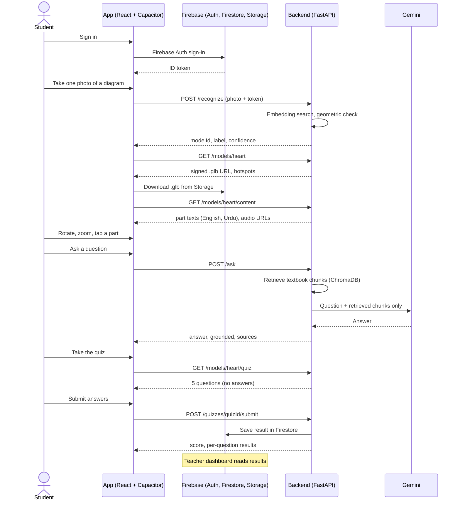
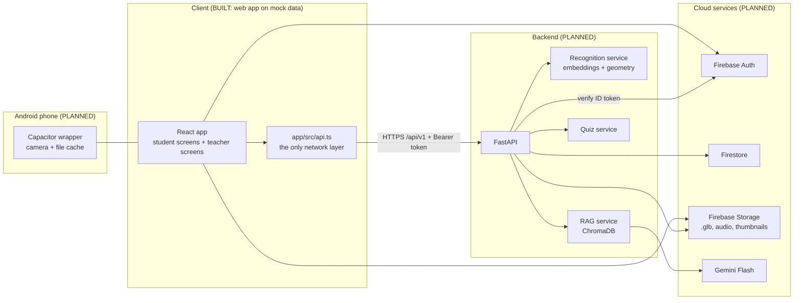

# TALEEM360

Scan a diagram in your Sindh Textbook Board science book. Explore it in 3D. Ask an AI tutor. Take a quiz. Your teacher sees the results.

**Labels used in this document**

- **BUILT (step X)**: exists in the repository today and was checked in that step.
- **PLANNED**: designed but not built yet. Nothing in the repo implements it.
- **PLACEHOLDER**: a route or file exists, but it only shows a "Coming in ..." page.
- **TBD**: not decided yet. We do not guess.

## Table of contents

1. [Project overview](#1-project-overview)
2. [Status and progress](#2-status-and-progress)
3. [How it works](#3-how-it-works)
4. [Tech stack](#4-tech-stack)
5. [Repository structure](#5-repository-structure)
6. [Getting started](#6-getting-started)
7. [Frontend in detail](#7-frontend-in-detail)
8. [Environment variables](#8-environment-variables)
9. [Backend integration](#9-backend-integration)
10. [API reference summary](#10-api-reference-summary)
11. [Recognition pipeline](#11-recognition-pipeline-planned)
12. [RAG tutor and quiz pipeline](#12-rag-tutor-and-quiz-pipeline-planned)
13. [Data model](#13-data-model-planned)
14. [3D assets plan](#14-3d-assets-plan)
15. [Security](#15-security)
16. [Git workflow](#16-git-workflow)
17. [Testing and verification checklist](#17-testing-and-verification-checklist)
18. [Known limitations and risks](#18-known-limitations-and-risks)
19. [Troubleshooting](#19-troubleshooting)
20. [Roadmap and glossary](#20-roadmap-and-glossary)

---

## 1. Project overview

**TALEEM360** is a STEM learning app for **STBB (Sindh Textbook Board) Classes 6 to 10**. It has two parts:

- a **student Android app** (React, packaged with Capacitor), and
- a **teacher web dashboard** (the same React project, desktop-first screens).

### The problem

Science diagrams in a printed textbook are flat. A student cannot rotate a heart, see inside a motor, or ask "why?" at home. Many students also study in both English and Urdu, and many use low-end Android phones.

### The idea

A student points the phone at a diagram in the book and takes **one photo**. The server recognises which diagram it is, and the app opens the matching **3D model**. The student can rotate and zoom it, tap parts to read short explanations in **English or Urdu**, ask an **AI tutor** that answers only from the textbook, and take a **5-question quiz**. Scores go to the teacher's dashboard.

### Who it is for

- **Students**, Classes 6 to 10, on low-end Android phones (target device: Redmi 12C).
- **Teachers**, who see class results on a laptop and can show a model on a projector.

### Team

| Role | Name |
|------|------|
| Team | Muhammad Umer Farooq, Muhammad Ebad Hafeez, Fizza Aman, Samrah Niazi |
| Supervisor | Miss Sadia Arshad |
| Co-supervisor | Dr. Usman Amjad |

### Scope: 12 models

| Class | Subject | Model |
|-------|---------|-------|
| 6 | Biology | Animal / plant cell |
| 7 | Biology | Digestive system |
| 8 | Science | Telescope |
| 6 to 8 | Science | Solar system (Ch 12 "Space and satellites" in the Class 6, 7 and 8 Science books) |
| 9 | Biology | Heart |
| 9 | Physics | Wind turbine |
| 9 | Chemistry | Bohr atom |
| 9 | Computer Science | Computer / motherboard |
| 10 | Biology | Lungs |
| 10 | Physics | DC motor |
| 10 | Chemistry | Hydrocarbon molecules |
| 10 | Computer Science | Logic gates / half-adder |

**Pilot = the heart only.** Everything is built and tested end to end on the heart first. The other 11 models reuse the same pipeline.

Exact chapter names for each model are TBD until the content is written.

---

## 2. Status and progress

| Step | Weight | Status |
|------|--------|--------|
| 0 | 5% | Done: monorepo skeleton |
| 1 | 15% | Done: 1A (Login, Home, responsive layout), 1B (Scan, Fetching, Viewer), 1C (api.ts aligned with the contract, Ask, Quiz, Result, Teacher dashboard, Projector). All on mock data |
| 2 | 10% | In progress: steps 2C and 2D done on a laptop (real heart `.glb` in model-viewer, all 9 parts selectable, floating labels). Phone test still pending. The other three models are still 3D stand-ins |
| 3 | 15% | Pending |
| 4 | 10% | Pending |
| 5 | 10% | Pending |
| 6 | 10% | Pending |
| 7 | 5% | Pending |
| 8 | 10% | Pending |
| 9 | 10% | Pending |

**Total complete: 20%** (step 0 and all of step 1).

Git tags that exist: `step-0`, `step-1a`, `step-1b`. `step-1c` is created by the user after committing step 1C.

Teacher dashboard and projector use the same Sticker lab look through `app/src/styles-teacher.css`. Logo: Planet Taleem, vector in `app/public/logo-planet.svg` (copy in `brand/`), used via `app/src/components/Logo.tsx` everywhere the brand shows. Camera and demo scan (branch ebad-work): Scan opens the back camera (`npm run dev:https` for the live camera on a phone over Wi-Fi); the photo is checked against `app/public/scan-pics/magnetic-bulb.png` by `app/src/mock/matcher.ts` (mock only, colour and patch check) and a match opens the Physics demo model, the electricity generator, with a bulb that has Off / Slow / Fast. Any other photo shows Diagram not found. See docs/PROGRESS.md. Sticker lab identity in `app/src/styles-sticker.css` (paper background with the doodle SVG `app/public/doodles.svg`, ink outlines, offset shadows, colour-block tiles, Baloo 2 headings), applied to all student screens. UI polish pass (not pushed): student type scale reduced about 10%, tighter spacing, soft card shadows, Login fits one screen with no scrollbar, scrollbars hidden inside the student column. Styles stay in `app/src/styles*.css`.

Also done: 1A responsive layout fix, Docs-1, Docs-1b and Docs-1c (documentation and contract fixes). The same table is kept in [docs/PROGRESS.md](docs/PROGRESS.md).

---

## 3. How it works

### End-to-end flow

1. **Login** (student or teacher). BUILT (step 1A) as a mock screen. Real login with Firebase Auth is PLANNED.
2. **Scan one photo.** The student frames one diagram and presses the shutter. The camera closes after one photo. The screen is BUILT (step 1B) with a drawn placeholder instead of a real camera. The real camera (Capacitor) is PLANNED.
3. **Server recognition.** The photo is uploaded; the server decides which diagram it is. PLANNED. A mock does this today.
4. **"Fetching 3D Model from Database."** An animated screen shows three steps while the app recognises the diagram and fetches the model. BUILT (step 1B). If the diagram is unknown, the student sees "Diagram not found" and can retake the photo. BUILT (step 1B).
5. **Download and cache the `.glb` file.** PLANNED. The mock model has an empty `glbUrl`.
6. **In-app viewer.** Title, parts list, an explanation card, an English/Urdu toggle and an audio button are BUILT (step 1B). **The heart is now the real 3D model** (`heart.glb` in `<model-viewer>`: drag to rotate, pinch or wheel to zoom, tap a part to select it, the chosen part glows teal, and floating name labels with a Labels button), BUILT (steps 2C and 2D). The heart has 9 selectable parts. Checked on a laptop only, not yet on a phone. The atom, DC motor and computer board are still stand-ins (`Stage3D`). Voice-over for the Electricity generator (English and Urdu) is BUILT (step 3A); the other models are PLANNED.
7. **AI tutor** (RAG over the textbook + Gemini). The chat screen is BUILT (step 1C) on mock answers (grounded answers with a source line, and a "not found in your book" answer). The real RAG + Gemini backend is PLANNED.
8. **5-question multiple-choice quiz**, marked automatically. The quiz and result screens are BUILT (step 1C) on mock data; the mock server marks the quiz with a private answer key. Real server-side marking is PLANNED.
9. **Results saved to Firestore.** PLANNED.
10. **Teacher dashboard and projector.** BUILT (step 1C) on mock data. Real data is PLANNED.

### Sequence diagram (target design)



### Architecture diagram (target design)



### Why one-time image recognition replaced continuous AR tracking

The original idea was live AR: keep tracking the diagram through the camera and draw the model on top (Unity with Vuforia or ARCore). We **dropped that** for three reasons:

- **Low-end phones.** Continuous tracking and 3D rendering together are heavy on a Redmi 12C.
- **Complexity and size.** A Unity app is large and slow to build; a React + Capacitor app is small and quick to change.
- **Reliability.** Textbook photos taken in classrooms are hard to track continuously. One good photo, checked on the server, is easier to make reliable.

The new design takes **one photo, recognises it once on the server, and opens a normal 3D viewer**. The earlier AR pilot repository **taleem360-pilot** is kept as a fallback. The change of approach still needs the supervisor's approval (see [Known limitations](#18-known-limitations-and-risks)).

---

## 4. Tech stack

Versions in the "Frontend (BUILT)" table are read from `app/package.json` (the `^` means "this version or a compatible newer one"). Planned versions are TBD until installed.

### Frontend (BUILT, step 1A and 1B)

| Layer | Tool | Version | Why chosen | Limitations |
|-------|------|---------|-----------|-------------|
| UI library | React | ^19.3.0 | Familiar to the team, large ecosystem | Needs a build step |
| UI library | react-dom | ^19.3.0 | Pairs with React | |
| Language | TypeScript | ^7.0.2 | Typed `api.ts` contract catches mistakes early | Slightly more setup |
| Build tool | Vite | ^8.3.4 | Fast dev server and small builds | |
| Vite plugin | @vitejs/plugin-react | ^6.1.2 | React support in Vite | |
| Routing | react-router-dom | ^7.18.4 | Simple client-side routes | |
| 3D viewer (heart only) | @google/model-viewer | 4.4.0 (pinned) | Loads a `.glb`, rotate, zoom and tap-on-part. Loaded on demand (its own 1 MB chunk, about 290 kB gzipped) so other screens stay small. BUILT (step 2C) | WebView 3D speed on a Redmi 12C is untested. Brings the `three` library with it |
| Font (English UI) | @fontsource/plus-jakarta-sans | ^5.3.0 | Bundled, works offline. Weights 400, 600, 700, 800 | Adds font files to the build |
| Font (Urdu) | @fontsource/noto-nastaliq-urdu | ^5.3.0 | Bundled, works offline. Weights 400, 600 | Large font files (about 160 to 220 kB each for the Arabic subset) |
| Styling | Plain CSS with CSS variables (design tokens) | n/a | No heavy UI library, small bundle | Hand-written styles |

### Planned layers

| Layer | Tool | Version | Why chosen | Limitations |
|-------|------|---------|-----------|-------------|
| Android packaging | Capacitor | TBD | Wraps the React app as an APK, gives camera and file access | Camera plugin quirks, WebView speed on low-end phones |
| Backend | FastAPI (Python) | TBD | Quick to write, automatic validation, good for ML code | Free hosting may sleep or have little RAM |
| Recognition | DINOv2-small or CLIP embeddings | TBD (choose after testing) | Match a photo to registered diagrams without training | Only registered diagrams are recognised |
| Recognition (check) | ORB or SIFT + RANSAC (OpenCV) | TBD | Geometric proof that the photo really shows the matched diagram | Can fail on blurry or dark photos |
| Recognition (optional) | Caption OCR | TBD | Reads "Fig 9.4" as an extra clue | OCR can misread; optional only |
| Vector store | ChromaDB | TBD | Simple local store for textbook chunks | Needs disk persistence on the host |
| LLM | Gemini Flash via `google-genai` | TBD | Fast and has a free tier | Free-tier limits; must be kept grounded in textbook text |
| Auth | Firebase Authentication | TBD | Ready-made login, roles via custom claims | Free-tier limits |
| Database | Cloud Firestore | TBD | Simple document storage for results | Free-tier read and write limits |
| File storage | Firebase Storage | TBD | Stores `.glb`, audio and thumbnails | Free-tier limits |
| Hosting | TBD | TBD | Backend and dashboard | Not chosen yet |

---

## 5. Repository structure

Real tree at the end of step 1C (folders that only hold a `.gitkeep` are reserved for later steps).

```text
taleem360/
├── CLAUDE.md                 Rules for every Claude Code session (safety, responsive, git)
├── README.md                 This file
├── .env.example              Placeholder names for backend and Firebase variables (no values)
├── .gitignore                Keeps secrets, build output and local data out of git
├── docs/
│   ├── README.md             One-line note about this folder
│   ├── PROGRESS.md           Progress table for steps 0 to 9
│   ├── API.md                Full API contract (PLANNED)
│   └── ui-preview/           READ-ONLY UI reference (screenshots/ and source/*.dc.html)
├── brand/
│   └── README.md             Reserved for logos and brand assets
├── app/                      The React project (package.json lives here, not in the root)
│   ├── README.md             One-line note
│   ├── package.json          Dependencies and scripts (dev, build, preview)
│   ├── package-lock.json     Exact installed versions
│   ├── index.html            Page shell (viewport-fit=cover, theme colour)
│   ├── vercel.json           Vercel: send every path to index.html (single-page app routing)
│   ├── vite.config.ts        Vite config with the React plugin
│   ├── tsconfig.json         TypeScript settings (strict)
│   ├── .env.example          VITE_USE_MOCK and VITE_BACKEND_URL placeholders
│   ├── .gitignore            node_modules, dist, .env files
│   ├── tools/make_voice.py       Makes the voice-over mp3 files from the part texts (edge-tts, step 3A)
│   ├── public/audio/generator/   The 10 voice-over mp3 files (5 parts x English and Urdu)
│   ├── public/models/heart.glb   The real heart model (1.1 MB, not compressed). Author and licence unknown (see Known gaps)
│   ├── public/fonts/         Reserved (fonts currently come from @fontsource)
│   └── src/
│       ├── main.tsx          Starts React, router, fonts and stylesheets
│       ├── App.tsx           Route table (every route is a real screen)
│       ├── api.ts            The ONLY place that talks to a backend (mock or real), follows docs/API.md
│       ├── types.ts          TypeScript types for the API contract
│       ├── vite-env.d.ts     Types for the VITE_* variables
│       ├── model-viewer.d.ts Lets TypeScript accept the <model-viewer> element in JSX
│       ├── styles.css        Design tokens, StudentShell, Login, Home, tab bar
│       ├── styles-1b.css     Scan, Fetching and Viewer styles
│       ├── styles-1c.css     Ask, Quiz, Result, teacher dashboard and projector styles
│       ├── styles-2c.css     The real 3D heart (viewer size, loading spinner)
│       ├── mock/
│       │   ├── data.ts       Sample data in the shape of the API responses
│       │   ├── subjects.ts   Sample models for Chemistry, Physics and Computer Science, and the id lookups
│       │   ├── answerKey.ts  PRIVATE quiz answer key (only the mock server reads it)
│       │   └── server.ts     The fake server: marks quizzes, answers tutor questions
│       ├── components/
│       │   ├── StudentShell.tsx   The one layout for every student screen
│       │   ├── TeacherLayout.tsx  Teacher layout: sidebar, or top bar with menu on narrow screens
│       │   ├── TabBar.tsx         Bottom tab bar (Home, Scan, Quizzes)
│       │   ├── ModelStage.tsx     The 3D area: the heart gets HeartViewer, the other three models get Stage3D; the flat SVG heart is the fallback
│       │   ├── HeartViewer.tsx    The real heart: <model-viewer>, part mapping, highlight, tap-to-select, camera aim, spinner, fallback
│       │   ├── glbSplit.ts        Gives each mesh in a .glb its own material in memory (the file on disk is not changed)
│       │   ├── Stage3D.tsx        Turnable 3D stand-in for the atom, motor and computer (drag, pinch/wheel, arrow keys)
│       │   ├── scene3d.ts         Tiny shaded-3D engine and the three scenes (no libraries)
│       │   ├── subjectArt.tsx     Flat textbook-page drawings of those models (Scan screen only)
│       │   └── Icons.tsx          Inline SVG icons
│       └── screens/
│           ├── Placeholder.tsx    "Coming in ..." page (no route uses it any more)
│           ├── student/
│           │   ├── Login.tsx      BUILT (1A)
│           │   ├── Home.tsx       BUILT (1A)
│           │   ├── Scan.tsx       BUILT (1B)
│           │   ├── Fetching.tsx   BUILT (1B)
│           │   ├── Viewer.tsx     BUILT (1B)
│           │   ├── Ask.tsx        BUILT (1C)
│           │   ├── Quiz.tsx       BUILT (1C)
│           │   └── Result.tsx     BUILT (1C)
│           └── teacher/
│               ├── TeacherDashboard.tsx  BUILT (1C)
│               └── TeacherProjector.tsx  BUILT (1C)
├── backend/                  PLANNED FastAPI backend (folders only, no code yet)
│   ├── README.md
│   ├── app/routers/          Reserved for route modules
│   ├── app/services/         Reserved for recognition, RAG and quiz services
│   ├── scripts/              Reserved for build and evaluation scripts
│   └── tests/                Reserved for backend tests
└── content/                  PLANNED learning content (folders only, no files yet)
    ├── README.md
    ├── models/               .glb files
    ├── references/           Reference images of textbook diagrams
    ├── test_photos/          Our own test photos for the recognition target
    ├── textbook_chunks/      Textbook text split into chunks for RAG
    └── quiz/                 Reviewed quiz questions
```

---

## 6. Getting started

Commands are for **Windows PowerShell**, one per line.

### Prerequisites

- **Node.js 18 or newer** (the project was built and checked with Node 24).
- **npm** (comes with Node).
- **git**.

Check them:

```powershell
node -v
npm -v
git --version
```

### Clone and install

```powershell
git clone <your-repository-url>
cd taleem360
cd app
npm install
```

`package.json` is in `app/`. Always run npm commands inside `app/`.

### Run the dev server

```powershell
npm run dev
```

Open the address Vite prints (usually `http://localhost:5173`). The app starts at the Login screen.

### Build for production

```powershell
npm run build
```

This runs the TypeScript check (`tsc -b`) and then `vite build`. The output goes to `app/dist/` (ignored by git). To look at the built version:

```powershell
npm run preview
```

### Deploy to Vercel

`app/vercel.json` makes every path fall back to `index.html`, so a page reload or a shared link such as `/viewer?model=generator` works with the app's `BrowserRouter` (without it, Vercel would answer 404 for any path except `/`). Real files (`/assets/...`, `/models/heart.glb`, `/audio/...`) are still served as files first.

Settings when you import the repository in Vercel:

| Setting | Value |
|---------|-------|
| Root Directory | `app` |
| Framework preset | Vite (Vercel detects it) |
| Build Command | `npm run build` |
| Output Directory | `dist` |
| Environment variables | **None needed** in mock mode (`VITE_USE_MOCK` defaults to mock). Never put a secret in a `VITE_*` variable |

### Try it on a real phone (same Wi-Fi)

```powershell
npm run dev -- --host
```

Vite prints a **Network** address such as `http://192.168.x.x:5173`. Open it in the phone's browser. The phone and the computer must be on the same Wi-Fi. If it does not load, allow Node through the Windows firewall when Windows asks.

### Mock mode

The app uses **mock data** by default (`VITE_USE_MOCK` is `true` unless it is exactly `false`). No backend is needed. Every call returns sample data after a short fake delay (350 ms).

### Test URLs

| URL | What it does |
|-----|--------------|
| `/login` | Start screen. Any email and password work in mock mode |
| `/home` | Home screen with sample student "Ayesha", Class 9 |
| `/scan` | Placeholder camera screen. `?subject=biology`, `chemistry`, `physics` or `cs` shows that subject's textbook page (the Home subject cards open these). No `subject` shows Biology |
| `/fetching?subject=physics` | **Mock only.** Recognises that subject's sample diagram (Biology: heart, Chemistry: carbon atom, Physics: electric motor, Computer Science: inside a computer) and opens its viewer |
| `/viewer?model=carbon-atom` | Chemistry sample. Also `dc-motor` (Physics) and `computer-hardware` (Computer Science). `/ask` and `/quiz` take the same `?model=` ids |
| `/fetching` | Normal flow: three steps, then opens `/viewer?model=heart` by itself (about 3 seconds) |
| `/fetching?fail=1` | **Mock only.** Forces "Diagram not found" with a "Retake photo" button |
| `/viewer?model=heart` | The viewer for the heart. `/viewer` with no `model` also opens the heart |
| `/ask?model=heart&part=aorta` | Chat with the mock tutor. Try "What is photosynthesis?" to see the "not found in your book" answer |
| `/quiz?model=heart` | The 5-question heart quiz. Submitting opens `/result` |
| `/result` | Opened without a quiz result it redirects to `/home` |
| `/teacher` | Teacher dashboard (also opened by "I am a teacher" on the Login screen) |
| `/teacher/projector?model=heart` | Teacher projector screen |

---

## 7. Frontend in detail

### Routes

Defined in `app/src/App.tsx`. Every route is a real screen. Any unknown path redirects to `/login`.

| Path | Screen file | Status | What it does | Where its buttons go |
|------|-------------|--------|--------------|----------------------|
| `/` | none | BUILT (1A) | Redirects | `/login` |
| `/login` | `screens/student/Login.tsx` | BUILT (1A) | Email and password form, calls the mock `login` | "Sign in as student" goes to `/home`. "I am a teacher" goes to `/teacher` |
| `/home` | `screens/student/Home.tsx` | BUILT (1A) | Greeting, scan card, four subject cards, recently opened, tab bar | Scan card goes to `/scan`. Subject cards go to `/scan`. Recently opened goes to `/viewer?model=<id>`. Tabs: Home `/home`, Scan `/scan`, Quizzes `/quiz` |
| `/scan` | `screens/student/Scan.tsx` | BUILT (1B) | Camera-style screen with a drawn textbook page, framing box, hint, shutter. **No real camera** | Close (X) goes to `/home`. Shutter goes to `/fetching` |
| `/fetching` | `screens/student/Fetching.tsx` | BUILT (1B) | Calls `recognize` then `getModel`, shows three animated steps, then opens the viewer. Shows "Diagram not found" or "Something went wrong" on failure | Automatic to `/viewer?model=<id>`. "Open the model" (enabled when done) goes to the viewer. "Wrong diagram? Scan again" goes to `/scan`. On failure: "Retake photo" goes to `/scan`, "Back to home" goes to `/home` |
| `/viewer` | `screens/student/Viewer.tsx` | BUILT (1B) | Title line, `ModelStage`, part buttons, explanation card, EN/Urdu toggle, audio button (reads the part aloud, generator only). Loads `getModel` and `getContent` | Back goes to `/home`. "Ask AI tutor" goes to `/ask?model=<id>&part=<partId>`. "Take quiz" goes to `/quiz?model=<id>` |
| `/ask` | `screens/student/Ask.tsx` | BUILT (1C) | Chat with the tutor about the model (and the part from `?part=`). Suggestion chips, user and tutor bubbles, typing indicator, source line under grounded answers, a distinct "Not found in your book" style when `grounded` is false. Urdu questions get `lang: ur`; Urdu answers use Noto Nastaliq Urdu, right to left. Input bar fixed at the bottom | Back goes to `/viewer?model=<id>` |
| `/quiz` | `screens/student/Quiz.tsx` | BUILT (1C) | Five questions one at a time, "Question N of 5" progress bar, options A to D, selected state, Next / Submit and finish. Calls `submitQuiz`. No correct answers are in the data the screen receives | Close (X) goes to `/viewer?model=<id>`. Submit goes to `/result` with the result in router state |
| `/result` | `screens/student/Result.tsx` | BUILT (1C) | Score ring, per-topic list (correct or "Review"), message by score, student name from `getMe`. Redirects to `/home` if opened without a result | "Review ... in 3D" goes to `/viewer?model=<id>`. "Back to home" goes to `/home` |
| `/teacher` | `screens/teacher/TeacherDashboard.tsx` | BUILT (1C) | Dashboard on mock data: class filter (from `getTeacherClasses`), three stat cards, results table with Strong / Okay / Needs help chips, "Where the class struggles" bars, "Sample data" badge. No `StudentShell` | "Scan a diagram" goes to `/teacher/projector?model=heart`. Sidebar: Overview, Scan to projector, Student results and Classes (scroll to the section), Model library (disabled, not built), Sign out goes to `/login` |
| `/teacher/projector` | `screens/teacher/TeacherProjector.tsx` | BUILT (1C) | Big `ModelStage`, parts list, explanation. Reads `?model=` (default `heart`). Client-only, no endpoint. No `StudentShell` | Back and "Stop presenting" go to `/teacher`. "Start class quiz on this model" goes to `/teacher` (placeholder action: there is no endpoint for it yet) |

### Layout and responsive rules

All student screens use **one** layout component, `components/StudentShell.tsx`. It takes a `tone` (`light`, `dark`, `camera` or `stage`), an optional `bottomBar` (the tab bar) and optional `decor` (such as the Login rings).

| Width | Behaviour |
|-------|-----------|
| 480 px or less (phone) | The screen fills the whole viewport, edge to edge, using `100dvh` so mobile browser bars do not cut it off |
| 481 px or more (tablet, laptop) | One centred column, `max-width: 430px`, full height, on a dark page (`#0B1624`) with a subtle border and shadow |

More rules (also in [CLAUDE.md](CLAUDE.md)):

- Content scrolls vertically **inside** the column. The bottom tab bar stays fixed at the bottom of the column.
- Decorations are clipped to the column, not the window.
- Safe areas: `viewport-fit=cover` is set in `index.html`; headers and bottom bars use `env(safe-area-inset-top)` and `env(safe-area-inset-bottom)`.
- Landscape phones (height under 500 px): the content scrolls, and the tab bar shrinks to 56 px with its icon and label side by side.
- No horizontal scroll anywhere.
- Teacher routes do **not** use `StudentShell`. They are full-width and desktop-first (BUILT, step 1C). The dashboard uses `components/TeacherLayout.tsx`: a dark sidebar on wide screens, and on screens 900 px wide or less a top bar with a menu button. The results table scrolls sideways inside its card, so the page never scrolls sideways. The projector page is a single full-width page with the same wrapping rules.

### ModelStage, HeartViewer and the 3D models

`components/ModelStage.tsx` draws the 3D area. It is used by the student Viewer and by the teacher projector. Its props did not change when the real heart was added:

```ts
interface ModelStageProps {
  model: ModelInfo          // from getModel (title, glbUrl, hotspots ...)
  parts: ContentPart[]      // from getContent (id, names, texts, colour)
  selectedPartId: string    // which part is highlighted
  onSelectPart: (partId: string) => void
}
```

Which component draws the model:

| Model | Drawn by | Status |
|-------|----------|--------|
| Heart | `HeartViewer` (real `heart.glb` in `<model-viewer>`) | BUILT (step 2C), checked on a laptop only |
| Carbon atom, DC motor, computer board | `Stage3D` (a lit, shaded stand-in drawn as SVG by `scene3d.ts`, turn by dragging, zoom with pinch or wheel) | BUILT stand-ins, real `.glb` files PLANNED |
| Anything else, or if the heart cannot load | The flat SVG heart (kept as the fallback) | BUILT |

The screens only know the four props above. They do not know how the 3D is drawn.

**HeartViewer (step 2C).** It loads `<model-viewer>` with a dynamic `import()` only when the heart is shown. In mock mode the model is the local file `${BASE_URL}models/heart.glb`; in real mode it is the `glbUrl` from `GET /models/{id}` (`api.ts` was not changed). Settings: camera controls on, auto-rotate off, `touch-action: pan-y` (vertical swipes still scroll the page), neutral lighting, transparent background, no interaction prompt. A small spinner shows while it loads. If the `.glb` fails to load or WebGL is not available, the flat heart is shown instead and one console warning is logged.

**Part mapping.** One constant, `HEART_PART_TO_MESH` in `HeartViewer.tsx`, maps content part ids to mesh names inside `heart.glb`. The heart has **9 selectable parts** (the first four are the original ones). Before trusting the mapping, each mesh was rendered on its own (and again with everything else made see-through) and checked by eye (step 2D):

| Content part id | Mesh in `heart.glb` | What the mesh looks like |
|-----------------|---------------------|--------------------------|
| `veins` | `Veins` | Thin blue-white vessels on the surface of the heart (the cardiac veins) |
| `pulmonary-trunk` | `Pulmonary_trunk` | The short, thick vessel at the top front |
| `valves` | `Valves` | A small cluster at the root of the great vessels, **inside** the heart |
| `aorta` | `Aorta` | The large arch and the vessel running down the back |
| `heart-muscle` | `Hart_basis` | The main muscle body of the heart |
| `coronary-vessels` | `Arteries2` | Red branching vessels on the surface |
| `av-valves` | `Avvalves` | Leaflets with thin strings, between the chambers, **inside** the heart |
| `atrial-appendage` | `Heartear` | The small ear-shaped pouch |
| `ligament` | `Ligament` | The thin yellow cord between the aorta and the pulmonary trunk |

A content part id that is not in the table gets no highlight and no label (the viewer just keeps the normal look).

**Selecting.** When the selected part changes (chip tap or tap on the model), that mesh gets a teal glow (`#14B8A6` at 40% strength), the other meshes get 40% darker, and the camera moves halfway toward the part and zooms in slightly, smoothly. A tap on the model uses `materialFromPoint`; a drag (more than 6 px) is ignored, so turning the heart never changes the selection. The two valve meshes sit inside the heart, so they cannot be tapped (or seen glowing); use their chips.

**Floating labels (step 2D).** Each of the 9 parts has a label (the part's English name and a dot in the part colour) made with a `<model-viewer>` hotspot (`slot="hotspot-<partId>"`). The label is anchored at the **centre of the mesh**, worked out once from the mesh's `POSITION` min and max in the `.glb` JSON (`glbSplit.ts` already reads it).
- The **selected part's label is always shown**. A **Labels** button in the corner of the stage turns on all labels; off by default and kept in component state only (nothing is saved).
- Labels hide when their part faces away from the camera, using `<model-viewer>`'s own hotspot visibility (`data-visibility-attribute`). The direction each label faces is found once after load by looking for the part's own surface next to its anchor; the two inside valve meshes use the direction "away from the middle of the heart".
- Labels never block taps (`pointer-events: none`), use 12 px text, are kept inside the stage, and are moved apart when they would overlap.
- Labels are English only for now: the Urdu toggle is not passed down to the stage.

**Why `glbSplit.ts` exists.** `heart.glb` has only two materials: one called `Veins` is shared by eight meshes, and `Ligament` has its own. So a tap or a highlight on "one material" would hit every shared mesh. `glbSplit.ts` reads the `.glb`, copies the shared material once per mesh (named after the mesh) in the JSON part of the file, and gives `<model-viewer>` a blob URL. The binary data is not touched and **the file on disk is never changed**. A `.glb` that already has one material per part passes through unchanged. The only network request is the `.glb` itself.

**How to add a new `.glb`:**

1. Export a plain `.glb`. **Do not compress it with meshopt or draco** (the viewer would have to download decoder files from the internet, and this app makes no extra network calls).
2. Keep it **under 3 MB** (heart.glb is 1.1 MB).
3. Give every part its own **named mesh** (node). Names must be unique. A shared material is fine (`glbSplit.ts` splits it), but the mesh names matter.
4. Put the file in `app/public/models/` (mock mode) or serve it from Storage (real mode, `glbUrl`).
5. Add a part-id to mesh-name table for the model (today `HEART_PART_TO_MESH`; copy the idea for the new model), make sure every content part id you want selectable is in it, and check each mapping by rendering the mesh on its own.
6. Check the licence and the author and write them down before the final demo.

### Design tokens

Defined as CSS variables in `app/src/styles.css`.

| Token | Value | Use |
|-------|-------|-----|
| `--ink` | `#0E1B2C` | Dark background, text on teal |
| `--primary` | `#0F766E` | Main brand colour, buttons, active tab |
| `--teal` | `#14B8A6` | Accent, shutter, primary button on dark |
| `--amber` | `#F59E0B` | Framing box, warnings |
| `--heart` | `#D6304A` | Heart / Biology icon colour |
| `--bg` | `#F4F7FA` | Light page background |
| `--card-border` | `#E3E9F0` | Card and chip borders |
| `--text` | `#12263A` | Body text |
| `--muted` | `#5B6B7D` | Secondary text |
| `--dark-muted` | `#B8C7D9` | Secondary text on dark |
| `--dark-faint` | `#8DA2BA` | Faint text on dark |
| `--dark-field` | `#15263B` | Input background on dark |
| `--dark-border` | `#2B3F57` | Input border on dark |

Other fixed colours: page behind the column `#0B1624`, camera screen `#0A121C`, viewer background gradient `#16283F` to `#0E1B2C`.

| Font | Use | Weights |
|------|-----|---------|
| Plus Jakarta Sans | All English UI text | 400, 600, 700, 800 |
| Noto Nastaliq Urdu | All Urdu text (class `.urdu`) | 400, 600 |

Spacing is hand-written in CSS (screen side padding 24 to 28 px, card radius 16 px, buttons 52 to 54 px high). The reference screens are in `docs/ui-preview/` (read-only).

### Mock data shapes

The mock data in `app/src/mock/data.ts` has exactly the shape of the responses in [docs/API.md](docs/API.md); the TypeScript types are in `app/src/types.ts`. All names and scores are sample data. The Biology sample (heart) is in `data.ts`. The Chemistry (`carbon-atom`), Physics (`dc-motor`) and Computer Science (`computer-hardware`) samples are in `app/src/mock/subjects.ts`, in the same shapes, each with four parts, a 5-question quiz (its answer key is in `answerKey.ts`) and mock tutor answers (in `server.ts`). **Their chapter names, figure numbers and page numbers are sample placeholders**: replace them with the real STBB book references when the content is checked. Main shapes:

```ts
Me             { uid, name, role, classLevel, classId }
HomeData       { student: { name, classLevel }, subjects: [{ id, name, examples }], recent: [{ modelId, title, subject, chapter }] }
RecognizeResult  { status: 'ok', modelId, label, confidence, matchedBy, figure } | { status: 'not_found', reason, tip }
ModelInfo      { id, title, titleUr, subject, classLevel, chapter, glbUrl, glbExpiresAt, glbSizeBytes, version, hotspots }
ModelContent   { modelId, source, defaultPartId?, parts: [{ id, nameEn, nameUr, textEn, textUr, audioEnUrl, audioUrUrl, color }] }
AskAnswer      { answer, lang, grounded, sources: [{ book, chapter, page }] }
Quiz           { quizId, modelId, questions: [{ id, text, options: [{ id, text }] }] }     // no correct answers
QuizSubmitResult { score, total, results: [{ questionId, correct, correctOptionId, topic }], savedResultId }
TeacherClasses { classes: [{ id, name, subject, studentCount }] }
TeacherResults { summary, rows: [{ studentName, modelId, score, total, label }], weakTopics }
```

The mock heart has **nine parts**: Veins, Pulmonary trunk, Valves, Aorta (the part selected first), Heart muscle, Coronary vessels, AV valves, Atrial appendage, Arterial ligament. The mock quiz has 5 heart questions. There are two mock classes (9-A and 9-B, Biology).

**The quiz answer key is private to the mock.** It lives in `app/src/mock/answerKey.ts` and is read only by `app/src/mock/server.ts` (the fake server). Screens never import it, and `getQuiz` never returns correct answers.

### How `api.ts` works

`app/src/api.ts` is the **only** file that talks to a backend. Screens import its functions and never call `fetch` themselves. It follows [docs/API.md](docs/API.md) (aligned in step 1C).

- `VITE_USE_MOCK`: mock mode is on unless the value is exactly `false`. `USE_MOCK` is exported so a screen can show "Sample data".
- `VITE_BACKEND_URL`: real requests go to `${VITE_BACKEND_URL}/api/v1<path>`.
- `getAuthToken()`: a **stub** that returns `null`. When it returns a token, `api.ts` sends `Authorization: Bearer <token>`. Firebase Auth fills it in at step 5.
- Errors: a non-2xx response body `{"error": {"code", "message"}}` becomes a typed `ApiError` with `code` (`invalid_request`, `invalid_image`, `unauthorized`, `forbidden`, `not_found`, `too_large`, `rate_limited` or `server_error`) and `status`. A network failure becomes `server_error`.
- `recognize` (real mode): the photo is resized to 1024 px (longest side) and re-encoded as JPEG before upload; a photo that cannot be read gives `invalid_image`, and one over 5 MB gives `too_large`.
- In mock mode every function waits 350 ms (the tutor 900 ms, so the typing indicator is visible) and returns sample data. The mock `submitQuiz` and `askQuestion` call the fake server in `mock/server.ts`.

| Function | Mock behaviour | Real endpoint (real mode) |
|----------|----------------|---------------------------|
| `login(email, password)` | **Mock only.** Returns a mock token for any input. Login becomes the Firebase Auth SDK in step 5; there is no backend login endpoint | none |
| `getMe()` | Sample student Ayesha, Class 9, class `9a` | `GET /me` |
| `getHomeData()` | Sample home data | `GET /home` |
| `listModels(params)` | The heart only, filtered by `subject` and `classLevel` | `GET /models` |
| `recognize(photo, { mockFail? })` | `ok` for the heart (confidence 0.94, `figure` "Fig 9.4"), or `not_found` with a tip if `mockFail` is true | `POST /recognize` (multipart, field `photo`) |
| `getModel(id)` | The heart model. Any other id gives `not_found` | `GET /models/{id}` |
| `getContent(id)` | The heart parts (English and Urdu) and source. Any other id gives `not_found` | `GET /models/{id}/content` |
| `askQuestion({ modelId, partId?, question, lang })` | Grounded answers with a source for three sample topics (aorta wall, valves, arteries and veins) in English or Urdu; anything else returns `grounded: false` and a "could not find this in your textbook" answer. An empty question gives `invalid_request` | `POST /ask` |
| `getQuiz(id)` | The 5 heart questions, **no correct answers** | `GET /models/{id}/quiz` |
| `submitQuiz(quizId, answers)` | The fake server marks the answers with its private key and returns per-question results. A malformed body gives `invalid_request`; an unknown quiz gives `not_found` | `POST /quizzes/{quizId}/submit` |
| `getTeacherClasses()` | Two sample classes | `GET /teacher/classes` |
| `getTeacherResults({ classId?, modelId? })` | Sample results for the chosen class | `GET /teacher/results` |

The mock server does **not** save quiz results, so the teacher dashboard numbers do not change when a student submits a quiz.

### Urdu and language handling

- There is **no i18n library**. English and Urdu text both come from the data (`name` / `nameUr`, `description` / `descriptionUr`).
- The Viewer has an **EN / اردو** toggle. In Urdu mode the part name and explanation are shown in Urdu only.
- Urdu text uses the `.urdu` class: font Noto Nastaliq Urdu, `direction: rtl`, `dir="rtl"` and `lang="ur"` on the element, and a roomy line height (about 2.3 on the explanation) so the tall script is not clipped.
- Both fonts are bundled by `@fontsource`, so they work offline.
- The app's own labels (buttons, hints, headings) are **English only** today. Translating the interface is TBD.
- Voice-over: the audio button reads the selected part aloud in the chosen language. BUILT for the Electricity generator only (step 3A, see below). The other models have no recordings yet, so for them the button does nothing.

### Voice-over (step 3A)

The audio button next to the part name reads the **selected part** aloud, in **English or Urdu** depending on the EN / اردو toggle. BUILT for the **Electricity generator (Physics) only**: 5 parts x 2 languages = 10 files. The other models keep `audioEnUrl` and `audioUrUrl` as `null`.

| Part | Files in `app/public/audio/generator/` |
|------|-----------------------------------------|
| Magnet, Coil, Slip rings, Brushes, Bulb | `magnet-en.mp3`, `magnet-ur.mp3`, `coil-en.mp3`, `coil-ur.mp3`, `slip-rings-en.mp3`, `slip-rings-ur.mp3`, `brushes-en.mp3`, `brushes-ur.mp3`, `bulb-en.mp3`, `bulb-ur.mp3` |

The files are about 585 KB in total (each 48 to 79 KB, 8 to 13 seconds, mono). The speech is **made by a computer voice** (free `edge-tts`, no API key): English `en-US-AriaNeural`, Urdu `ur-PK-UzmaNeural` (fallbacks `en-GB-SoniaNeural` and `ur-PK-AsadNeural`). It reads the existing `textEn` and `textUr`; the text was not rewritten.

How the button behaves (`screens/student/Viewer.tsx`):
- **Tap** = play the selected part in the current language. **Tap again** = stop. The button shows the real state (`onended`, `onpause`, `onerror`).
- Choosing another part, switching EN / اردو, or leaving the screen **stops** the voice.
- Sound starts **only after a tap**, never by itself (phones require this).
- One `HTMLAudioElement` is reused for all parts.
- If the mp3 cannot be loaded or played, it falls back silently to the browser's own speech (`speechSynthesis`, `en-US` or `ur-PK`) with the same text. If that fails too, nothing happens: no alert, no crash.
- A part with no audio URL (every model except the generator): the button does nothing and shows no error.

**How to make the files again** (needs an internet connection while it runs; nothing is sent except the part text). From the `app/` folder:

```powershell
pip install edge-tts
python tools/make_voice.py
```

`python tools/make_voice.py --list` only prints the texts. The script reads the texts from `src/mock/subjects.ts` (`generatorContent`), so after you change a text, run it again and the mp3 files are overwritten. To add voice for another model, add its content constant name to `CONTENT_CONST` in `tools/make_voice.py`, run it, and set the `audioEnUrl` and `audioUrUrl` of its parts (the path is `/audio/<model>/<partId>-en.mp3`).

### Accessibility and tap targets

- Every tappable element is at least **44 x 44 px**. Hotspots are 44 px buttons around a smaller visible dot.
- Inputs use a font size of at least 16 px (this also stops iOS-style zoom on focus).
- No hover-only behaviour.
- Icon-only buttons have `aria-label`; toggle buttons use `aria-pressed`; the Fetching progress bar has `role="progressbar"` and the status line is `aria-live`.
- The pulsing step animation and the progress transition are turned off when the user prefers reduced motion.
- Decorative SVGs are `aria-hidden`; the figure drawings have text labels.

---

## 8. Environment variables

**Never put real values in this file, in git, or in chat.** Real values live only in `.env` files, which are in `.gitignore`. Only `.env.example` files (placeholders) are committed.

### App (`app/.env`)

| Name | Status | Meaning | Example placeholder |
|------|--------|---------|---------------------|
| `VITE_USE_MOCK` | BUILT (1A) | `true` uses mock data. Set to `false` to call the real backend | `true` |
| `VITE_BACKEND_URL` | BUILT (1A) | Backend origin, no trailing slash. When the contract is applied the code will add `/api/v1` | `http://localhost:8000` |
| `VITE_FIREBASE_API_KEY` | PLANNED | Firebase web config for Auth, Firestore and Storage | `your-firebase-api-key` |
| `VITE_FIREBASE_AUTH_DOMAIN` | PLANNED | Same | `your-project.firebaseapp.com` |
| `VITE_FIREBASE_PROJECT_ID` | PLANNED | Same | `your-project-id` |
| `VITE_FIREBASE_STORAGE_BUCKET` | PLANNED | Same | `your-project.appspot.com` |
| `VITE_FIREBASE_MESSAGING_SENDER_ID` | PLANNED | Same | `your-sender-id` |
| `VITE_FIREBASE_APP_ID` | PLANNED | Same | `your-app-id` |

Anything starting with `VITE_` is visible to anyone who opens the app, so it must never be a secret. (Firebase web config values are identifiers, not secrets; access is protected by Firebase rules.)

### Backend (`backend/.env`, PLANNED)

| Name | Meaning | Example placeholder |
|------|---------|---------------------|
| `GEMINI_API_KEY` | Key for Gemini. **Secret** | `your-gemini-api-key` |
| `FIREBASE_PROJECT_ID` | Firebase project used to verify ID tokens | `your-project-id` |
| `GOOGLE_APPLICATION_CREDENTIALS` | Path to the Firebase service-account file on the server. The file itself is **never** committed | `path/to/service-account.json` |
| `CHROMA_PATH` | Folder where ChromaDB stores its data | `./chroma_db` |
| `ALLOWED_ORIGINS` | Comma-separated list of allowed web origins for CORS | `http://localhost:5173` |

The exact backend variable names are TBD until step 4; these are the planned names.

### Root `.env.example` (BUILT, step 0; names updated in Docs-1b)

The root file lists the same placeholder names as the two tables above: the `VITE_*` variables for the app (copy them into `app/.env`) and the backend variables (copy them into `backend/.env`). It contains placeholders only.

---

## 9. Backend integration

### Rules

- The React app talks to the backend **only** through `app/src/api.ts`. No screen calls `fetch`.
- Mock data first: every feature is built and checked on mock data before a backend exists.
- Base URL: `${VITE_BACKEND_URL}/api/v1`. The version is in the path.
- Auth: a **Firebase ID token** in `Authorization: Bearer <token>` on every endpoint except `GET /health`. The role (`student` or `teacher`) is a custom claim. Teacher endpoints return 403 to students.
- Login is done by the Firebase Auth SDK in the app (step 5), not by a backend endpoint.
- Requests and responses are JSON, except the photo upload (`multipart/form-data`).
- Errors use one format for every non-2xx response:

```json
{ "error": { "code": "not_found", "message": "Model 'xyz' does not exist." } }
```

  Codes: `invalid_image`, `invalid_request` (malformed body), `too_large`, `unauthorized`, `forbidden`, `not_found`, `rate_limited`, `server_error`. A "diagram not recognised" result is a normal `200` with `"status": "not_found"`.
- **CORS:** the backend allows only the origins in `ALLOWED_ORIGINS` (the dev server and the real dashboard origin). The Android app runs from a Capacitor origin, which must be added to the list (exact value TBD in step 7).

### Switching from mock to real

1. Start the backend (PLANNED).
2. In `app/.env` set:

```text
VITE_USE_MOCK=false
VITE_BACKEND_URL=http://localhost:8000
```

3. Restart `npm run dev` (Vite reads `.env` at start).

No screen code changes. That is the point of `api.ts`. Step 4 will first align `api.ts` with the contract (see the gaps below).

### Known gaps: current real-mode `api.ts` versus the contract

Step 1C aligned `api.ts` and the mock data with [docs/API.md](docs/API.md). **Fixed in step 1C:** the `/api/v1` prefix, every path and request or response shape in the contract, the `invalid_request` code and the typed `ApiError`, the `Authorization` header hook, the 1024 px JPEG resize for photos, `getMe` with `classId`, `listModels`, `getTeacherClasses`, `classId` in `getTeacherResults`, parts moved from `getModel` to `getContent`, and the quiz answer key moved out of the data the screens see. The invented `POST /auth/login` is removed.

**What is still different or untested:**

1. **Real mode has never run against a backend.** No backend exists yet, so every real-mode call is untested.
2. **No token is sent yet.** `getAuthToken()` returns `null` (stub), so no `Authorization` header is sent until Firebase Auth (step 5).
3. **`login` is mock only.** There is no endpoint for it; the Firebase Auth SDK replaces it in step 5. `GET /health` has no function in `api.ts`.
4. **The Fetching screen still sends an empty placeholder blob.** In real mode `recognize` would reject it with `invalid_image` until the real camera photo is wired in (a later step). The resize helper (`createImageBitmap` and a canvas) is untested on real photos and in Android WebView.
5. **One addition to the contract:** `GET /models/{id}/content` may include an optional `defaultPartId` (the part selected first in the viewer). It is documented in `docs/API.md` as an addition; if the backend does not send it the viewer selects the first part.
6. **Screens use generic error messages.** Only the Ask screen treats `rate_limited` differently. Other codes (`unauthorized`, `forbidden`) are not handled yet; step 5 should send an unauthorised user to the login screen.
7. **Unused or action-less pieces:** `listModels` has no screen yet (Model library is not built); "Start class quiz on this model" on the projector has no endpoint and only returns to the dashboard; the teacher's "Student results" and "Classes" sidebar items only scroll to a section.
8. **The mock server is simple.** The tutor knows three sample topics, the mock does not save quiz results, and `savedResultId` is fake.
9. **heart.glb author and license unknown - must be credited or replaced before the final demo.**
10. **The real heart is untested on a phone.** Step 2C was checked on a laptop (Chrome with software WebGL). Speed in Android WebView on a Redmi 12C, and real touch pinch and drag, are not tested.
11. **Only the heart is a real model.** The atom, DC motor and computer board are still `Stage3D` stand-ins until their `.glb` files exist.
12. **Real mode for the model URL is untested.** In real mode the heart uses `glbUrl` from `GET /models/{id}` and downloads it with `fetch`, so the file host must allow it (CORS).
13. **Content for the 5 new heart parts (and their Urdu) was written from general anatomy, not from the textbook: verify against Class 9 Biology Ch 9 and ask the teacher.** (Heart muscle, Coronary vessels, AV valves, Atrial appendage, Arterial ligament.)
14. **The mesh called `Veins` is the thin cardiac veins on the surface of the heart, not the great veins** (vena cava, pulmonary veins), which are not in this model. The text of the existing "Veins" chip ("Vessels that carry blood back to the heart") is general, so check that it fits what students see.
15. **Labels are approximate.** A label sits at the centre of its mesh's box, which can be away from the visible part (the aorta's centre is inside the heart body). A label also hides once its part faces away from the camera as it was first seen, even if another side of the part is visible (the aorta is visible from the back but its label hides). The two inside valve meshes cannot be seen or tapped.
16. **Voice-over is a computer voice and only for the Electricity generator (Physics).** Listen to the Urdu files before showing them: check how "Coil", "Slip rings", "Brushes" and "Bulb" are pronounced (they are English words written in Urdu letters). A human recording can replace any file with the same name. Not yet tested on a real iPhone or Android phone.
17. **Dev-only console warnings.** In `npm run dev` the console shows two Lit warnings from `<model-viewer>` (dev build notice, and a property set after load). They do not appear in the production build.

---

## 10. API reference summary

All endpoints are **PLANNED** (no backend exists). Every one is mocked in `api.ts` today, and every `api.ts` function already follows this contract. Base URL `${VITE_BACKEND_URL}/api/v1`. Full details, request and response examples: **[docs/API.md](docs/API.md)**.

| Method | Path | Auth | Purpose | `api.ts` function | Status |
|--------|------|------|---------|-------------------|--------|
| GET | `/health` | none | Liveness and version | none (not needed by a screen) | PLANNED |
| GET | `/me` | student or teacher | Current user, role, class level and class id | `getMe` | PLANNED |
| GET | `/home` | student | Home screen data | `getHomeData` | PLANNED |
| GET | `/models?subject=&classLevel=` | student or teacher | List models | `listModels` | PLANNED |
| POST | `/recognize` | student | Photo to model id | `recognize` | PLANNED |
| GET | `/models/{id}` | student or teacher | Model info and signed `.glb` URL | `getModel` | PLANNED |
| GET | `/models/{id}/content` | student or teacher | Part texts (English, Urdu), audio URLs | `getContent` | PLANNED |
| POST | `/ask` | student | AI tutor answer from the textbook | `askQuestion` | PLANNED |
| GET | `/models/{id}/quiz` | student | 5 questions, no answers | `getQuiz` | PLANNED |
| POST | `/quizzes/{quizId}/submit` | student | Mark quiz, save result | `submitQuiz` | PLANNED |
| GET | `/teacher/classes` | teacher only | The teacher's classes (ids used as `classId`) | `getTeacherClasses` | PLANNED |
| GET | `/teacher/results?classId=&modelId=` | teacher only | Class results (`classId` comes from `/teacher/classes`) | `getTeacherResults` | PLANNED |
| none | `/teacher/projector?model=<id>` (a screen, not an endpoint) | teacher | Client-only projector view | none | PLANNED |

Rate limit (planned): 30 requests per minute per user on `/recognize` and `/ask`.

---

## 11. Recognition pipeline (PLANNED)

Goal: given one photo, say which registered textbook diagram it shows, or say "not found". Nothing here is built yet.

1. **Reference images.** For each diagram we keep one or more clean reference images in `content/references/`, listed in the registry (see [section 13](#13-data-model-planned)).
2. **Embeddings.** Each reference image is turned into a vector with DINOv2-small or CLIP (we choose by testing on our own photos). The vectors are stored in an index.
3. **Search.** The uploaded photo (resized to a longest side of 1024 px) gets a vector. We find the **top 5** closest references.
4. **Geometric verification.** For the best candidates we match ORB or SIFT keypoints between the photo and the reference and run **RANSAC** to check that the two images really share the same layout. This stops "looks similar" mistakes.
5. **"Not found" rule.** If the best candidate has low similarity, or the geometric check fails, the server returns `status: "not_found"` with a tip. It never guesses. Exact thresholds are TBD and will be set from test results.
6. **Optional caption OCR.** Reading a caption such as "Fig 9.4" can add a clue or break a tie. Optional, only if testing shows it helps.
7. **Result.** On success the server returns the model id, label, confidence, which method matched (`matchedBy`) and the figure name.

**Target:** at least **90% top-1 accuracy on our own test photos** (photos of the real textbook pages taken with the target phone in normal classroom light, kept in `content/test_photos/`). This is a **goal, not a result**. No measurement exists yet.

**Evaluation script plan:** `backend/scripts/` will get a script that runs every test photo through the pipeline and prints top-1 accuracy, top-5 accuracy, the not-found rate and a list of wrong answers, so thresholds can be tuned.

**Risks:** blurry or dark photos; glare on glossy pages; photos that cut off part of the figure; diagrams that look alike across chapters; needing permission to use the textbook images; only registered diagrams can ever be recognised.

---

## 12. RAG tutor and quiz pipeline (PLANNED)

### Tutor (RAG)

1. **Chunking.** The textbook text for each model's chapter is split into short chunks (a few sentences each) with the book, chapter and page kept as metadata. Chunks go in `content/textbook_chunks/`.
2. **Store.** Chunks are embedded and stored in **ChromaDB** (`CHROMA_PATH`).
3. **Retrieve.** For each question the backend retrieves the closest chunks, filtered by the current model.
4. **Prompt.** Gemini Flash gets the question and **only the retrieved chunks**, with the instruction to answer only from them, in the student's language (English or Urdu).
5. **"Not in your book" fallback.** If nothing relevant is retrieved, or the model says the chunks do not contain the answer, the backend returns `grounded: false` and an answer that says it was not found in the book. It must not answer from general knowledge.
6. **Sources.** Every grounded answer lists its sources (book, chapter, page).

### Quiz

- Each model has a **5-question multiple-choice quiz**, generated **once** per model (with Gemini from the textbook chunks), then **stored** (`content/quiz/` and Firestore).
- A teacher or team member **reviews** the questions before they go live.
- `GET /models/{id}/quiz` returns the questions and options only. **Correct answers are never sent to the client before submitting.**
- `POST /quizzes/{quizId}/submit` marks the answers on the server, saves the result and then returns which answers were right.

---

## 13. Data model (PLANNED)

Nothing in this section exists yet. Field names may change in steps 5 and 6.

### Firestore collections

**`users`** (document id = Firebase uid)

| Field | Type | Notes |
|-------|------|-------|
| `name` | string | Display name |
| `role` | string | `student` or `teacher` (also a custom claim) |
| `classLevel` | number | 6 to 10, students only |
| `classId` | string | Which class the user belongs to |
| `createdAt` | timestamp | |

**`classes`**

| Field | Type | Notes |
|-------|------|-------|
| `name` | string | For example "Class 9-A" |
| `classLevel` | number | |
| `teacherUid` | string | |
| `studentUids` | array of strings | |

**`scans`**

| Field | Type | Notes |
|-------|------|-------|
| `studentUid` | string | |
| `modelId` | string | |
| `confidence` | number | |
| `createdAt` | timestamp | The photo itself is **not** stored |

**`quizResults`**

| Field | Type | Notes |
|-------|------|-------|
| `studentUid` | string | |
| `classId` | string | |
| `modelId` | string | |
| `quizId` | string | |
| `score` | number | |
| `total` | number | |
| `answers` | array | `{ questionId, optionId, correct, topic }` |
| `createdAt` | timestamp | |

### Firebase Storage layout

```text
models/{modelId}.glb             3D models (version in metadata)
thumbs/{modelId}.webp            Thumbnails
audio/{modelId}/{partId}-en.mp3  English audio
audio/{modelId}/{partId}-ur.mp3  Urdu audio
```

### `content/registry.json` schema

One file links everything. Illustrative example (TBD until step 3):

```json
{
  "diagrams": [
    {
      "id": "heart-fig-9-4",
      "figure": "Fig 9.4",
      "referenceImages": ["references/heart-fig-9-4.jpg"],
      "modelId": "heart",
      "model": "models/heart.glb",
      "subject": "Biology",
      "classLevel": 9,
      "chapter": "Ch 9 Transport",
      "topic": "Human heart",
      "chunks": ["textbook_chunks/class9-bio-ch9.jsonl"],
      "quiz": "quiz/heart.json"
    }
  ]
}
```

The chain is: diagram, reference image, model, subject / class / topic, textbook chunks.

### `.glb` requirements

- **Not compressed with meshopt or draco**, and **under about 3 MB** per model so it loads on a weak connection and phone. (The real `heart.glb` is 1.1 MB and uncompressed.)
- **One named mesh per part.** Material names do not matter (shared materials are split at load time, see `glbSplit.ts`), but every selectable part needs its own mesh with a unique name.
- Mesh names must be listed in the part-id to mesh-name table used by the viewer (`HEART_PART_TO_MESH` for the heart), and the part ids must match the `part.id` values in the content endpoint.

---

## 14. 3D assets plan

| Phase | Models | Method |
|-------|--------|--------|
| Phase 1 | Cell, digestive system, telescope, heart, lungs | **Meshy** (AI generation) for organic and object models, or **Sketchfab** models that are already split into parts |
| Phase 2 | The other 7 (solar system, wind turbine, Bohr atom, computer / motherboard, DC motor, hydrocarbon molecules, logic gates / half-adder) | Mix of Meshy, Sketchfab and hand-built models |

Models that are better **built by hand** (for example in Blender): DC motor, atom, molecules, logic gates, because they must be exact and split into named parts.

Checks for every model:

- **Licence:** the licence allows use in an educational app (Sketchfab models must be CC-licensed for reuse; note the credit).
- **Textbook accuracy:** the parts and their names match the STBB textbook and a teacher agrees.
- **Size and parts:** under about 3 MB, one named material per part (Meshy often outputs a **single mesh**, which must be split before it is useful).

---

## 15. Security

- **Secrets policy:** never commit `.env`, API keys, passwords, tokens, Firebase service-account files or keys of any kind. Only `.env.example` with placeholder names is committed. Before every commit run `git status` and `git diff --staged` and check for secrets.
- **`.gitignore` covers:** `node_modules`, `.env`, `.env.*` (except `.env.example`), `*.pem`, `*.key`, `serviceAccount*.json`, `firebase-adminsdk*.json`, `google-services.json`, `GoogleService-Info.plist`, `.firebase/`, `__pycache__`, `venv`, `dist`, `app/android/build`, `*.pdf`, ChromaDB folders (`chroma/`, `chroma_db/`, `.chroma/`), `*.sqlite3`, `*.tsbuildinfo`, `.vscode/`, `Thumbs.db`, `.DS_Store`.
- **Firebase rules plan (PLANNED):** students can read their own `users` document and their own `quizResults`, and cannot write results directly (only the backend can). Teachers can read results for their own classes only. Storage files are read through signed URLs. Rules are tested before release.
- **Token auth (PLANNED):** every endpoint except `/health` needs a Firebase ID token, verified on the server. Roles are custom claims; teacher endpoints return 403 to students.
- **Rate limiting (PLANNED):** for example 30 requests per minute per user on `/recognize` and `/ask`.
- **Photo handling:** the photo is used for recognition and then discarded. It is **not stored** unless we later decide we need it for improving recognition (TBD, would need consent).
- **Textbook content:** STBB diagrams are used for **internal matching only** and are not republished. Permission is still to be confirmed (see risks).
- **VITE variables are public.** Never put a secret in a `VITE_*` variable.
- **No real personal data in the repository or docs.** Names in mock data and examples are samples.

---

## 16. Git workflow

- **One step at a time.** Each step is small and checked before the next.
- **Claude Code never commits.** It must not run `git add`, `git commit`, `git tag` or `git push`. The user does that in PowerShell after each step.
- **Before committing,** check for secrets:

```powershell
git status
git diff --staged
```

- **Commit message format:** `Step N: short description`, for example `Step 1B: Scan, Fetching, Viewer screens with ModelStage`.
- **Tags:** `step-0`, `step-1a`, `step-1b`, and so on, one per finished step.
- **Typical sequence:**

```powershell
git add .
git status
git commit -m "Step N: short description"
git tag step-n
git push origin main --tags
```

- **Branches:** work is on `main` for now. When Muhammad Ebad Hafeez joins, use `feature/*` branches and merge them through pull requests.
- **CRLF warnings** such as "LF will be replaced by CRLF" on Windows are harmless.

---

## 17. Testing and verification checklist

Do these at the end of **every** step.

- [ ] `cd app` then `npm run build` finishes with no errors.
- [ ] `npm run dev` starts and the changed screens open.
- [ ] Layout checked at 360x640, 390x844, 412x915, 844x390 (landscape), 768x1024, 1366x768 and 1920x1080: no horizontal scroll, nothing overlapped by the tab bar.
- [ ] Every tappable element is at least 44 x 44 px; inputs are at least 16 px.
- [ ] Urdu text (if shown) is not clipped and reads right to left.
- [ ] Mock mode works with no backend running.
- [ ] No change to code that already worked (compare with `git diff`).
- [ ] `.gitignore` still covers `.env`, `node_modules` and `dist`; no secrets in `git status` or `git diff --staged`.
- [ ] `README.md` and `docs/PROGRESS.md` updated.
- [ ] Commit, tag and push done by the user.

Backend steps (PLANNED) add: every endpoint in `docs/API.md` returns the documented shape and error format; the quiz response contains no correct answers; the teacher endpoint returns 403 for a student token.

---

## 18. Known limitations and risks

| Risk | Detail |
|------|--------|
| WebView 3D speed | A 3D model inside Android WebView on a Redmi 12C may be slow or stutter. Not tested yet. This is why models are kept under about 3 MB |
| Capacitor camera plugin | Camera plugins have quirks across Android versions (permissions, orientation, image size). The real camera is not built yet |
| Free hosting | Free backend hosting may have little RAM (embedding models are heavy) and may sleep, making the first request slow |
| Free tiers | Gemini and Firebase free tiers have request limits. A whole class using the app at once could hit them |
| Only registered diagrams | Recognition only knows diagrams we registered. Anything else returns "not found" |
| Meshy single mesh | Meshy often outputs one mesh with one material. It must be split into named parts before tapping parts works |
| Urdu font bundling | The Urdu font files are large (about 160 to 220 kB each), which adds to the app size. They are bundled so Urdu works offline |
| Audio | Only the Electricity generator has voice-over, and it is a computer voice. The other models have none yet. Urdu pronunciation must be checked by ear |
| Textbook diagram permission | We need permission (or a safe way) to use STBB diagrams as reference images |
| Supervisor approval | The change from live AR to one-time recognition must be approved by the supervisor |
| Mock only | Today nothing talks to a real server, so real network behaviour, errors and speed are untested |
| Mock server stands in for the backend | In mock mode `api.ts` simulates the server (marks quizzes with a private answer key, answers from three sample topics). Real server behaviour, errors and speed are untested |

---

## 19. Troubleshooting

**"Repository not found" when pushing, even though the repo exists.** A stale GitHub credential is stored in Windows. Clear it, then push again and sign in when asked:

```powershell
git credential-manager erase
```

When it waits for input, type these two lines, then press Enter on an empty line:

```text
protocol=https
host=github.com
```

**`npm` says it cannot find `package.json`.** You are in the wrong folder. `package.json` is in `app/`, not the repository root:

```powershell
cd app
npm install
```

**Line-ending warnings ("LF will be replaced by CRLF").** Harmless on Windows. You can ignore them.

**Port 5173 is busy.** Another dev server is running. Vite will normally pick the next port (5174) and print it; use that address. Or stop the other one, or choose a port:

```powershell
npm run dev -- --port 5180
```

**The phone cannot open the dev address.** Start with `npm run dev -- --host`, make sure the phone and computer are on the same Wi-Fi, and allow Node through the Windows firewall.

**Changed `.env` but nothing happened.** Stop and restart `npm run dev`. Vite reads `.env` only at start.

---

## 20. Roadmap and glossary

### Roadmap

**Confirmed** means the scope was decided for this project; **proposed** means a suggestion for the team to confirm; **TBD** means not decided. Weights are from the progress table.

| Step | Weight | Scope | Test (proposed) |
|------|--------|-------|-----------------|
| 1C | (part of 15%) | Done: `api.ts` aligned with `docs/API.md`; Ask, Quiz, Result, Teacher dashboard and Projector screens on mock data | All routes are real screens; build passes; full flow walked at 390x844 and 1366x768 |
| 2 | 10% | Confirmed: real `<model-viewer>`. Heart done on a laptop (steps 2C and 2D: 9 parts, labels); phone test and the other models still to do | Heart `.glb` rotates, zooms and a tapped part updates the text; smooth on a real phone |
| 3 | 15% | Confirmed: recognition spike (a script plus about 20 real photos) | At least 90% top-1 on those photos |
| 4 | 10% | Confirmed: FastAPI backend following `docs/API.md`, and `api.ts` aligned with the contract. Rest TBD | Every endpoint returns the documented shape; app works with `VITE_USE_MOCK=false` |
| 5 | 10% | Confirmed: Firebase Auth login. Rest TBD (proposed: Firestore for results) | Student and teacher sign in; teacher endpoint rejects a student |
| 6 | 10% | Confirmed: RAG tutor (Class 9 Biology Ch 9 text in ChromaDB; the ask-a-question endpoint answers from the book) | Answers come only from the book; "not in your book" fallback works |
| 7 | 5% | Confirmed: quiz (5 heart questions generated once, stored, auto-marked, saved) | Quiz is marked on the server and the result is saved; correct answers are not sent before submitting |
| 8 | 10% | Confirmed: teacher dashboard on real data, plus the projector | Teacher sees real results for a class; projector opens a model |
| 9 | 10% | Confirmed: polish (logo, Urdu font and text, audio, full-flow phone test, APK, demo video) | Full flow works on a real phone from the APK |

### Glossary

| Term | Meaning |
|------|---------|
| STBB | Sindh Textbook Board, which publishes the textbooks for Classes 6 to 10 |
| GLB | A single-file 3D model format (binary glTF). The viewer loads `.glb` files |
| RAG | Retrieval-Augmented Generation: find relevant textbook text first, then let the AI answer using only that text |
| Embedding | A list of numbers that represents an image or text, so similar things are close together |
| RANSAC | A method that finds the best consistent match between two sets of points while ignoring wrong matches |
| ORB / SIFT | Methods that find distinctive points ("keypoints") in an image so two images can be compared |
| Capacitor | A tool that wraps a web app as an Android app and gives it access to the camera and files |
| model-viewer | Google's web component that displays a `.glb` model and lets users rotate, zoom and tap hotspots |
| Hotspot | A tappable point on a 3D model that is tied to one part |
| ChromaDB | A small database that stores embeddings and finds the closest ones |
| Mock | Sample data that stands in for the real backend during development |

## Contributions log: Muhammad Ebad Hafeez

Changes made by Muhammad Ebad Hafeez (with Claude as coding assistant). Newest first. Keep adding a row for every change he makes.

| Date | Change | Files |
|---|---|---|
| 2026-10-23 | Step 3A: voice-over for the Electricity generator. The audio button now speaks the selected part in English or Urdu (10 mp3 files made with edge-tts), stops on part, language or screen change, and falls back to browser speech. Other models unchanged. | `tools/make_voice.py` (new), `public/audio/generator/*.mp3` (new), `mock/subjects.ts` (audio URLs only), `screens/student/Viewer.tsx` |
| 2026-10-14 | Step 2D: all 9 heart parts selectable (5 new parts with English and Urdu text, mapping checked by eye), floating labels with a Labels button, labels kept inside the stage and apart. Laptop only. | `mock/data.ts`, `components/HeartViewer.tsx`, `styles-2c.css` |
| 2026-10-14 | Step 2C: the heart is now the real `heart.glb` in `<model-viewer>` (4.4.0). Part highlight, tap to select, camera aim, spinner, flat-heart fallback. Laptop only. | `components/HeartViewer.tsx`, `glbSplit.ts`, `model-viewer.d.ts`, `styles-2c.css` (new); `components/ModelStage.tsx`, `main.tsx`, `package.json` |
| 2026-10-13 | Real 3D stand-ins (shaded, drag to rotate, pinch/wheel zoom, idle sway, animation) for the carbon atom, DC motor and computer board. Heart stays flat. | `components/scene3d.ts` (new), `components/Stage3D.tsx` (new), `components/ModelStage.tsx`, `components/subjectArt.tsx`, `styles-1b.css` |
| 2026-10-13 | Subject tabs fixed: Chemistry, Physics and Computer Science open their own sample model, parts, quiz and tutor answers in mock mode (Home card passes `?subject=` through Scan and Fetching). Chapter/page labels are placeholders to check against the real STBB books. | `mock/subjects.ts` (new), `mock/answerKey.ts`, `mock/server.ts`, `api.ts`, `screens/student/Home.tsx`, `Scan.tsx`, `Fetching.tsx`, `Ask.tsx`, `docs/PROGRESS.md` |

### Details: 3D models for Chemistry, Physics and Computer Science (2026-10-13)

**Done by:** Muhammad Ebad Hafeez (with Claude as coding assistant).

**What was done**
- The three non-biology sample models now open as real 3D scenes in the viewer instead of flat drawings:
  - **Atom** (Chemistry): carbon atom with a nucleus of 6 protons and 6 neutrons, 2 electrons in the K shell and 4 valence electrons in the L shell. Electrons orbit.
  - **Circuit** (Physics): a DC motor with its circuit: magnets (N and S), battery and wires, brushes, split-ring commutator and a spinning coil.
  - **Motherboard** (Computer Science): a circuit board with CPU, two RAM sticks, SSD, PCIe slot, chipset and capacitors.
- You can drag to rotate, pinch or scroll to zoom, or use the arrow keys and + / -. Models sway gently when idle. Tapping a part selects it, same as before. Animation is switched off when the phone has "reduce motion" on.
- No new libraries: the 3D is drawn as SVG by a small engine written for this project. It is a **stand-in**; step 2 replaces it with the real `<model-viewer>` and `.glb` files.
- The heart and the textbook-style figures on the Scan screen are still flat (unchanged on purpose).

**Files**
- New: `app/src/components/scene3d.ts` (3D engine and the three scenes), `app/src/components/Stage3D.tsx` (the viewer component with rotate, zoom and hotspots).
- Changed: `components/ModelStage.tsx` (hands these three models to `Stage3D`), `components/subjectArt.tsx` (now only the flat textbook figures for the Scan screen), `styles-1b.css` (touch and cursor styles for the 3D stage), `README.md`, `docs/PROGRESS.md`.

**How it was tested:** drawn in headless Chrome from several angles; drag, tap, drag-on-a-hotspot, wheel zoom and reduced-motion checked; type-checked. **Not yet run** in the real app or on a real phone: run `npm run dev` and `npm run build`, then test on the Redmi 12C.

**Known gaps:** hotspot dots are large and can overlap; labels can cover parts; no "drag to rotate" hint yet; models fill only about half the stage. Chapter and page labels on the sample models are placeholders to verify against the real STBB books.

Not done yet (ideas noted): smaller hotspot dots, leader-line labels, a "drag to rotate" hint, larger default model size, stage background, colour swatches in the parts list.
